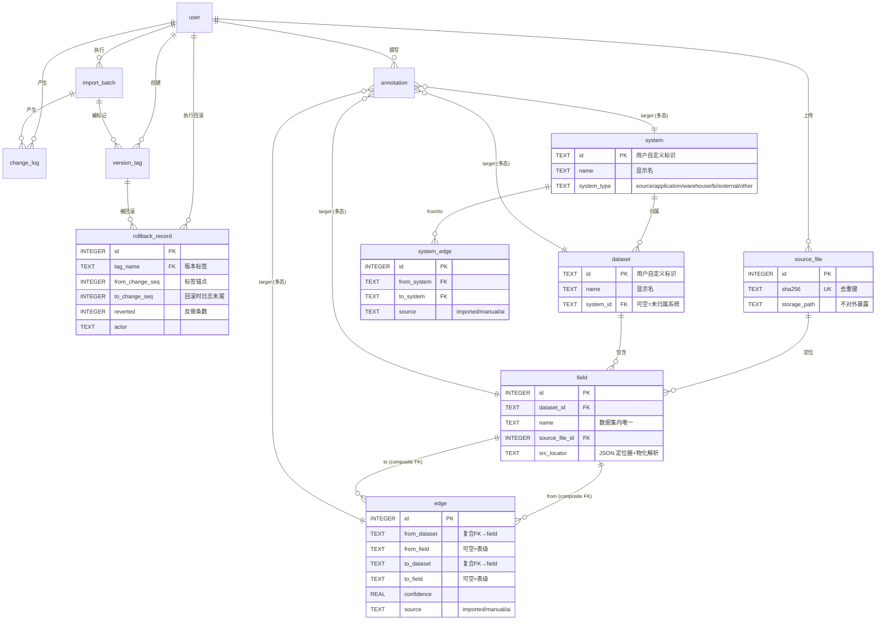

# Clew 数据模型（Data Model）

> 对应《Clew-业务模型.md》的数据层实现模型，细化自《Clew-设计方案.md》第四章。**2026-11 起为双库模型**：SQLite（§一–九）是唯一事实源（方言以 SQLite 为基准、预留 Postgres 升级路径，差异处标注）；Kùzu 0.11.3 承担血缘拓扑遍历（§十，派生层，可随时从 SQLite 全量重建）。
>
> **2026-11 系统级血缘扩展（设计已定稿，代码待实现）**：新增 `system` 目录与 `system_edge` 显式边，`dataset.system_id` 记录归属；系统级关系由「显式边 ∪ 数据集边投影」合并为 `v_system_edge`，并投影到 Kùzu `System` 节点与 `LINEAGE_SYSTEM` 关系。系统属性/搜索在 SQLite，系统级链路遍历在 Kùzu，沿用同一分层（设计方案 §4.7）。

---

## 一、模型总览

核心思路：**「当前态」存 13 张基础表 + 「派生视图」 + 「JSON 结构」三类附属定义，外加 1 张单行同步状态表 `graph_state`（§2.12，2026-11 双库方案新增）**。当前态即最新业务状态（读写主路径）；历史与版本靠 `change_log` 追加日志重建（回滚/diff 的依据），不做全量快照。第 10 张表 `rollback_record` 是 M3 新增的**按标签回滚审计**（回滚本身不写 change_log，见 §七）；第 11 张表 `description_draft` 是 M5 新增的 AI 描述草稿工作区；`graph_state` 记录 Kùzu 派生图与主库的同步状态（§十）；第 12/13 张表 `system` / `system_edge` 是 2026-11 系统级血缘新增的**系统目录与显式系统边**（§2.13/§2.14）。



> 说明：`edge` 是 field 的自反多对多关系（字段级血缘）；`from_field`/`to_field` 为 NULL 表示表级血缘。`annotation` 为多态关联（`target_kind` + `target_id`），图中画成三条虚连线。

---

## 二、表定义

### 2.1 user（用户）

| 列 | 类型 | 约束 | 说明 |
|---|---|---|---|
| id | INTEGER | PK AUTOINCREMENT | |
| username | TEXT | UNIQUE NOT NULL | 登录名 |
| password_hash | TEXT | NOT NULL | 加盐哈希，永不明文 |
| display_name | TEXT | | 显示名 |
| role | TEXT | NOT NULL CHECK(IN('admin','editor','viewer')) | RBAC 角色 |
| created_at | TEXT | NOT NULL | ISO8601 UTC（SQLite 统一存 TEXT） |

### 2.2 source_file（源文件托管，第一手资料文件库）

| 列 | 类型 | 约束 | 说明 |
|---|---|---|---|
| id | INTEGER | PK AUTOINCREMENT | 文件库 ID，导入清单 `src_file` 引用它 |
| original_name | TEXT | NOT NULL | 原始文件名（保留展示） |
| storage_path | TEXT | NOT NULL | 实际存储路径（默认本地 `data/files/`），**不对外暴露**，访问走受控 API |
| sha256 | TEXT | UNIQUE NOT NULL | 内容指纹，去重键：同内容上传复用同一条记录 |
| size_bytes | INTEGER | | |
| src_type | TEXT | NOT NULL CHECK(IN('csv','xlsx','json')) | 决定定位器结构与实文件核查方式 |
| uploaded_by | TEXT | NOT NULL REFERENCES user(username) | |
| created_at | TEXT | NOT NULL | |

### 2.3 dataset（数据集，血缘节点）

| 列 | 类型 | 约束 | 说明 |
|---|---|---|---|
| id | TEXT | PK | 用户自定义标识（导入清单里的 `dataset_id`） |
| name | TEXT | | 显示名 |
| description | TEXT | | |
| system_id | TEXT | NULL，REFERENCES system(id) ON DELETE SET NULL | 所属系统（2026-11 系统级血缘新增）；NULL = 未归属系统，不进入系统图 |
| created_at / updated_at | TEXT | NOT NULL | |

### 2.4 field（字段，血缘追溯最小单元）

| 列 | 类型 | 约束 | 说明 |
|---|---|---|---|
| id | INTEGER | PK AUTOINCREMENT | 代理键，供画布/程序引用 |
| dataset_id | TEXT | NOT NULL REFERENCES dataset(id) | |
| name | TEXT | NOT NULL | |
| field_type | TEXT | | 自由文本类型描述 |
| source_file_id | INTEGER | NOT NULL REFERENCES source_file(id) | 每个字段必须挂一个已托管源文件（不变量#1） |
| src_locator | TEXT | NOT NULL | JSON：定位器 + 实文件解析物化结果（见 4.1） |
| description | TEXT | | 导入的原始说明（人工见解走 annotation，不写此列） |
| created_at / updated_at | TEXT | NOT NULL | |

**唯一约束**：`UNIQUE(dataset_id, name)` —— 字段自然键，边表复合 FK 的引用目标。

### 2.5 edge（血缘边，表级 + 字段级统一）

| 列 | 类型 | 约束 | 说明 |
|---|---|---|---|
| id | INTEGER | PK AUTOINCREMENT | |
| from_dataset | TEXT | NOT NULL，复合 FK → field(dataset_id, name)（见下） | 上游数据集 |
| from_field | TEXT | NULL=表级边 | 上游字段 |
| to_dataset | TEXT | NOT NULL，复合 FK 同上 | 下游数据集 |
| to_field | TEXT | NULL=表级边 | 下游字段 |
| transform | TEXT | | 转换说明（SQL 片段/公式/文字），只供理解不执行 |
| confidence | REAL | DEFAULT 1.0，CHECK(0≤x≤1) | 置信度；AI 边 < 1.0 |
| source | TEXT | NOT NULL CHECK(IN('imported','manual','ai')) | 血缘来源 |
| note | TEXT | | |
| created_by / updated_by | TEXT | REFERENCES user(username) | 操作留痕 |
| created_at / updated_at | TEXT | NOT NULL | |

**唯一约束（自然键）**：同一上下游对只允许一条边（不变量#3）。注意：SQLite 的 UNIQUE 对含 NULL 的组合按 `NULLS DISTINCT` 语义处理（任意 NULL 互不相等），表级边（from_field/to_field 均为 NULL）无法被 `UNIQUE(from_dataset, from_field, to_dataset, to_field)` 拦截。M1 实现改用两个部分唯一索引保证该不变量（见 `src/clew/db.py` 的 DDL）：
- 字段级边：`CREATE UNIQUE INDEX uq_edge_field ON edge(from_dataset, from_field, to_dataset, to_field) WHERE from_field IS NOT NULL AND to_field IS NOT NULL;`
- 表级边：`CREATE UNIQUE INDEX uq_edge_table ON edge(from_dataset, to_dataset) WHERE from_field IS NULL AND to_field IS NULL;`

**复合外键**：`(from_dataset, from_field) REFERENCES field(dataset_id, name)`、`(to_dataset, to_field) REFERENCES field(dataset_id, name)`。NULL 成员默认放行（MATCH SIMPLE），与「表级边」语义一致。

### 2.6 import_batch（导入批次 = 版本）

| 列 | 类型 | 约束 | 说明 |
|---|---|---|---|
| id | INTEGER | PK AUTOINCREMENT | |
| version_no | INTEGER | UNIQUE NOT NULL | 递增版本号 v1, v2… |
| file_names | TEXT | | 本批清单文件名（JSON 数组） |
| format | TEXT | NOT NULL CHECK(IN('csv','xlsx','json')) | 清单物理格式 |
| report | TEXT | | 导入报告 JSON（见 4.3），可下载 |
| created_by | TEXT | NOT NULL REFERENCES user(username) | |
| created_at | TEXT | NOT NULL | |
| rolled_back_at | TEXT | | 回滚时间；批次回滚或标签回滚反做该批次时写入 |
| rolled_back_by | TEXT | REFERENCES user(username) | 回滚执行者 |

### 2.7 version_tag（版本业务标签）

| 列 | 类型 | 约束 | 说明 |
|---|---|---|---|
| id | INTEGER | PK AUTOINCREMENT | |
| name | TEXT | UNIQUE NOT NULL | 业务标签名（如 `v2.1-r1`） |
| note | TEXT | | 标签说明（如「Q3 口径修正发布」） |
| batch_id | INTEGER | REFERENCES import_batch(id) | 打标签时的最近批次（信息性，回滚不依赖它） |
| change_seq | INTEGER | NOT NULL | 锚定的 change_log 位置；回滚到标签 = 反做该 seq 之后的全部变更 |
| created_by | TEXT | NOT NULL REFERENCES user(username) | |
| created_at | TEXT | NOT NULL | |

**留痕说明（M3）**：标签创建以 `created_by/created_at` 留痕，**不写 `change_log`**——否则「回滚到更早标签」会把标签本身当作可反做数据删除，违背业务规则「标签永久保留」。标签名唯一，重名创建返回 409。

### 2.8 annotation（标注，追加式业务说明）

| 列 | 类型 | 约束 | 说明 |
|---|---|---|---|
| id | INTEGER | PK AUTOINCREMENT | |
| target_kind | TEXT | NOT NULL CHECK(IN('dataset','field','edge','system','system_edge')) | 多态关联类型（system/system_edge 为 2026-11 新增） |
| target_id | TEXT | NOT NULL | 命名规则见 5.2；**无外键**（多态），完整性由应用层校验目标存在 |
| body | TEXT | NOT NULL | 说明内容 |
| author | TEXT | NOT NULL REFERENCES user(username) | 取自 JWT，不可伪造 |
| created_at | TEXT | NOT NULL | 只增不改（不变量#5），无 updated_at |

### 2.9 change_log（变更日志，版本重建依据）

| 列 | 类型 | 约束 | 说明 |
|---|---|---|---|
| id | INTEGER | PK AUTOINCREMENT | 即全局递增 `change_seq` |
| batch_id | INTEGER | NULL=人工编辑，REFERENCES import_batch(id) | |
| entity_kind | TEXT | NOT NULL CHECK(IN('dataset','field','edge','system','system_edge','graph')) | 变更对象类型（system/system_edge 为 2026-11 新增；graph 为图重建留痕，不参与反做） |
| entity_key | TEXT | NOT NULL | 命名规则见 5.2 |
| op | TEXT | NOT NULL CHECK(IN('added','updated','deleted')) | |
| before | TEXT | NULL（added 时为空） | 变更前 JSON 快照 |
| after | TEXT | NULL（deleted 时为空） | 变更后 JSON 快照 |
| actor | TEXT | NOT NULL REFERENCES user(username) | |
| created_at | TEXT | NOT NULL | |

### 2.10 rollback_record（按标签回滚审计，M3 新增）

| 列 | 类型 | 约束 | 说明 |
|---|---|---|---|
| id | INTEGER | PK AUTOINCREMENT | |
| tag_name | TEXT | NOT NULL REFERENCES version_tag(name) | 被回滚到的业务标签 |
| from_change_seq | INTEGER | NOT NULL | 标签锚定的 change_seq（区间起点，不含） |
| to_change_seq | INTEGER | NOT NULL | 回滚发生时 change_log 的最大 id（区间终点，含） |
| reverted | INTEGER | NOT NULL | 本次反做的日志条数 |
| actor | TEXT | NOT NULL REFERENCES user(username) | 执行回滚的管理员 |
| created_at | TEXT | NOT NULL | |

**为什么单独建表**：回滚操作若写 `change_log`，下一次回滚会把「回滚日志」再反做一次，破坏「重复回滚安全」；同时 `change_log` 需要保持「可反做业务变更」的纯净语义（`graph` 重建留痕不参与反做）。因此回滚审计落在 `rollback_record`，满足「写必留痕」而不污染版本反做边界。

### 2.11 description_draft（AI 描述草稿，M5 新增）

AI 自动补描述的工作区：草稿**不触碰** `field.description`（原始导入值），用户在 UI 确认采纳后才写 `annotation`（追加式业务说明）；被拒绝的字段不再重复生成。

| 列 | 类型 | 约束 | 说明 |
|---|---|---|---|
| id | INTEGER | PK AUTOINCREMENT | |
| dataset_id | TEXT | NOT NULL REFERENCES dataset(id) | |
| field_name | TEXT | NOT NULL；外键 `field(dataset_id, name)`，级联删除/更新 | 草稿目标字段 |
| draft | TEXT | NOT NULL，1~400 字符 | AI 生成的描述草稿 |
| model | TEXT | NOT NULL | 生成所用模型名（审计） |
| status | TEXT | NOT NULL CHECK IN ('pending','accepted','rejected')，DEFAULT 'pending' | 生命周期 |
| created_at | TEXT | NOT NULL | |
| decided_at | TEXT | 可空 | 采纳/拒绝时间 |

唯一约束 `(dataset_id, field_name, status)`：同一字段同时只有一条 pending 草稿，accepted/rejected 历史可并存留痕。表为 AI 工作区，**不写 change_log**（采纳时业务痕迹落在 annotation）。设计与流程见 [03_dev/07_AI模块演进规划](../03_dev/07_AI模块演进规划.md) §4.5。

### 2.12 graph_state（Kùzu 派生图同步状态，2026-11 双库方案新增）

单行表（恒为 `id=1`），记录 Kùzu 血缘图（§十）与主库的同步水位与状态。它是「SQLite 唯一事实源」原则下的**双库协调器**：图写失败标脏、读前检查、自动重建的判据都来自这一行。

| 列 | 类型 | 约束 | 说明 |
|---|---|---|---|
| id | INTEGER | PK，CHECK(id=1) | 恒为 1 |
| last_edge_id | INTEGER | NOT NULL DEFAULT 0 | 已同步到 Kùzu 的 `edge.id` 水位（重建时用增量/全量判断，M2 先全量） |
| state | TEXT | NOT NULL CHECK(IN('clean','dirty','rebuilding'))，DEFAULT 'clean' | clean=图可信；dirty=图待重建（读路径走自动重建→失败降级 CTE）；rebuilding=重建进行中 |
| node_count | INTEGER | | 最近一次重建后的图节点数（展示/审计用，含 System/Dataset/Field 节点） |
| rel_count | INTEGER | | 最近一次重建后的图边数（与 SQLite `edge` + `v_system_edge` 总数对账） |
| system_rel_count | INTEGER | | 最近一次重建后的系统级关系数（与 `SELECT COUNT(*) FROM v_system_edge` 对账，2026-11 新增） |
| rebuilt_at | TEXT | | 最近一次重建完成时间 |
| rebuilt_by | TEXT | REFERENCES user(username) | 重建触发者（auto=自动，或管理员用户名） |

> 单行约束由应用层保证（INSERT OR IGNORE + 固定 id=1）。`rel_count/node_count` 是**廉价对账**：导入完成后自动比对 `rel_count` 与主库边数，不一致标脏；全量 `clew graph audit` 再做 edge_id 集合级精确比对（§十）。

### 2.13 system（系统目录，2026-11 系统级血缘新增）

系统是数据集之上的**可选**归属层，用于展示系统间上下游。属性与入口检索全部在 SQLite；系统级链路遍历由 Kùzu `System` 节点承担（§十）。

| 列 | 类型 | 约束 | 说明 |
|---|---|---|---|
| id | TEXT | PK | 用户自定义系统标识（如 `crm` / `dw_platform`） |
| name | TEXT | | 显示名 |
| description | TEXT | | 系统说明 |
| system_type | TEXT | NOT NULL DEFAULT 'other'，CHECK(IN('source','application','warehouse','bi','external','other')) | 系统类型；决定画布图标/颜色与筛选 |
| owner | TEXT | | 业务负责人（自由文本，不参与权限判定） |
| created_at / updated_at | TEXT | NOT NULL | |

**唯一约束**：`id` 主键；`name` 不要求唯一（不同团队可有同名系统，标识才是键）。

### 2.14 system_edge（显式系统级血缘，2026-11 系统级血缘新增）

只登记**无法从数据集级血缘推导**的粗粒度系统关系（如「财务系统 → 数据仓库：月度对账 Excel」）。能从 `edge` + `dataset.system_id` 投影出来的关系不落此表，查询时由 `v_system_edge` 合并（§3.3）。

| 列 | 类型 | 约束 | 说明 |
|---|---|---|---|
| id | INTEGER | PK AUTOINCREMENT | 显式边主键，供编辑/删除/AI 转正定位 |
| from_system | TEXT | NOT NULL REFERENCES system(id) | 上游系统 |
| to_system | TEXT | NOT NULL REFERENCES system(id) | 下游系统 |
| transform | TEXT | | 接口/加工方式说明（如「T+1 批量文件」「Kafka 实时同步」） |
| confidence | REAL | DEFAULT 1.0，CHECK(0≤x≤1) | 置信度；AI 候选 < 1.0 |
| source | TEXT | NOT NULL CHECK(IN('imported','manual','ai')) | 来源；AI 候选必须人工确认后转 `manual` |
| note | TEXT | | 备注 |
| created_by / updated_by | TEXT | REFERENCES user(username) | 操作留痕 |
| created_at / updated_at | TEXT | NOT NULL | |

**唯一约束**：`UNIQUE(from_system, to_system)`（同一上下游系统对只允许一条显式边，不变量#3 在系统层的延伸）；`CHECK(from_system <> to_system)` 禁止自环。

**为什么不存 derived 边**：投影边是 `edge` + `dataset.system_id` 的派生结果，落库会引入「数据集边改了、系统边忘了改」的双写漂移；查询时用 `v_system_edge` 实时合并即可。显式边落库是因为它承载投影无法表达的业务信息，并且必须参与版本与回滚。

---

## 三、派生视图

### 3.1 v_dataset_edge（表级血缘，派生不落库）

字段级边自动推导表级边；独立的表级边（字段为 NULL）原样保留：

```sql
CREATE VIEW v_dataset_edge AS
SELECT DISTINCT from_dataset, to_dataset FROM edge
UNION
SELECT from_dataset, to_dataset FROM edge
WHERE from_field IS NULL AND to_field IS NULL;
```

> 设计理由：避免 OpenMetadata 式「两套边存储双写」的一致性问题——表级关系永远是字段级关系的投影。

### 3.2 字段检索（search_fields 工具的支撑）

M4 实现**未引入 FTS5 虚拟表**，`search_fields`（`prototype/backend/src/lineagelite/ai/tools.py`）直接对 `field` / `dataset` / `annotation` 做 SQLite `LIKE` 模糊匹配：

```sql
-- 实际实现（简化）：数据集 id/名称、字段名、字段描述、字段标注
SELECT ... FROM field f JOIN dataset d ON d.id = f.dataset_id
WHERE lower(f.dataset_id) LIKE :pattern
   OR lower(COALESCE(d.name, '')) LIKE :pattern
   OR lower(f.name) LIKE :pattern
   OR lower(COALESCE(f.description, '')) LIKE :pattern
   OR EXISTS (SELECT 1 FROM annotation a
              WHERE a.target_kind = 'field'
                AND a.target_id = f.dataset_id || '.' || f.name
                AND lower(a.body) LIKE :pattern)
ORDER BY CASE
           WHEN lower(f.name) = :exact THEN 0
           WHEN lower(f.name) LIKE :prefix THEN 1
           ELSE 2
         END,
         f.dataset_id, f.name
LIMIT 20;
```

**取舍**：当前数据规模（小团队、单机 SQLite）下 `LIKE` 全表扫描足够；FTS5 需要触发器或应用层双写维护，M4 未引入，因此不建 `field_fts`。数据量增长后可再引入 FTS5，或迁移 Postgres 后换 `tsvector` + GIN 索引，`search_fields` 的接口与排序语义保持不变。

### 3.3 v_system_edge（系统级关系：显式 ∪ 投影，2026-11 新增）

系统级关系有两个来源，查询时合并为一张视图，**不物化、不双写**：

1. **explicit**：`system_edge` 中登记的显式系统边；
2. **derived**：把 `edge` 两端的 dataset 经 `dataset.system_id` 映射到系统，按「数据集对」去重计数；同一系统内部的数据集边被排除（不产生自环）；
3. **both**：同一对系统既有显式边又有投影边；显式边的业务属性优先，投影边只贡献 `dataset_edge_count` 证据计数。

```sql
CREATE VIEW v_system_edge AS
WITH derived AS (
  SELECT d_from.system_id AS from_system,
         d_to.system_id   AS to_system,
         COUNT(DISTINCT e.from_dataset || '->' || e.to_dataset) AS dataset_edge_count,
         MIN(e.confidence) AS confidence
  FROM edge e
  JOIN dataset d_from ON d_from.id = e.from_dataset
  JOIN dataset d_to   ON d_to.id   = e.to_dataset
  WHERE d_from.system_id IS NOT NULL
    AND d_to.system_id IS NOT NULL
    AND d_from.system_id <> d_to.system_id
  GROUP BY d_from.system_id, d_to.system_id
),
explicit AS (
  SELECT id, from_system, to_system, transform, confidence, source, note
  FROM system_edge
)
SELECT e.from_system, e.to_system,
       CASE WHEN d.from_system IS NOT NULL THEN 'both' ELSE 'explicit' END AS origin,
       COALESCE(d.dataset_edge_count, 0) AS dataset_edge_count,
       e.id AS system_edge_id,
       e.transform, e.confidence, e.source, e.note
FROM explicit e
LEFT JOIN derived d ON d.from_system = e.from_system AND d.to_system = e.to_system
UNION ALL
SELECT d.from_system, d.to_system, 'derived', d.dataset_edge_count,
       NULL, NULL, d.confidence, 'derived', NULL
FROM derived d
LEFT JOIN explicit e ON e.from_system = d.from_system AND e.to_system = d.to_system
WHERE e.id IS NULL;
```

**列语义**：

| 列 | 说明 |
|---|---|
| `origin` | `explicit` / `derived` / `both`；UI 必须展示，保证系统边可解释 |
| `dataset_edge_count` | 贡献该边的数据集级边数（按 `from_dataset→to_dataset` 去重）；纯显式边为 0 |
| `system_edge_id` | 显式边主键；纯投影边为 NULL |
| `confidence` | 显式边取 `system_edge.confidence`；纯投影边取底层边最小值 |
| `source` | 显式边取 `system_edge.source`；纯投影边固定 `derived` |

**实现注意**：

- `COUNT(DISTINCT e.from_dataset || '->' || e.to_dataset)` 依赖标识中不含 `->`；若未来允许任意字符，改用子查询按 `(from_dataset,to_dataset)` 分组计数；
- 视图不参与 `change_log` 反做；回滚后由 `graph_state` 标脏触发 Kùzu 重建；
- 数据集归属变更（`dataset.system_id`）会立即改变投影结果，不需要维护任何系统边表。

---

## 四、JSON 结构定义（存 TEXT 列，导入时 pydantic 校验）

### 4.1 field.src_locator（源文件定位器 + 物化解析结果）

统一信封：`{ "type": <src_type>, "input": <用户填写>, "resolved": <实文件解析物化> }`

```jsonc
// type = csv
{ "type": "csv",
  "input":  { "column": 3 }                       // 或 { "header": "order_no" }
, "resolved": { "column_index": 3, "header": "order_no" } }

// type = xlsx（简单列定位）
{ "type": "xlsx",
  "input":  { "sheet": "订单明细", "column": "D", "row_start": 2, "row_end": 15000 }
, "resolved": { "column_index": 4, "column": "D",
                "row_start": 2, "row_end": 15000, "merged_anchors": [] } }

// type = xlsx（多级表头 + 合并单元格）
{ "type": "xlsx",
  "input":  { "sheet": "订单", "header_path": ["商品信息", "订单号"], "header_rows": 2, "row_start": 3 }
, "resolved": { "column_index": 4, "column": "D",
                "row_start": 3, "row_end": null,
                "merged_anchors": [ { "value": "商品信息", "anchor": "B1", "range": "B1:F1" } ] } }
// 归一化规则：落在合并区域内的定位一律物化为左上角锚点 anchor + 合并范围 range

// type = json
{ "type": "json",
  "input":  { "json_path": "$.data.items[*].order_no" }
, "resolved": { "hits": 3 } }   // 实文件核查取到的 JSONPath 命中数
```

**实现说明**：`resolved` 只物化解析结果（`column_index` / `column` / `row_start` / `row_end` / `merged_anchors` / `hits`），**不写 `verified_at`**；核查发生的批次、操作者与时间由 `import_batch` / `change_log` 留痕，回源预览响应中的 `verification`（§9.1）返回最近一次通过实文件核查的版本号、操作者与时间。

**不变量**：`resolved` 由导入器对托管源文件（openpyxl/标准库 json）解析后写入；`input` 保留用户原始填写以便回看与失效排查。`type` 与所属 source_file 的 `src_type` 必须一致（应用层校验）。

**M3 人工修正定位器**：`PATCH /fields/{dataset_id}/{field_name}` 提供 `src_locator` 时，必须**重新执行结构校验 + 实文件核查**并重写整个信封（`resolved` 重新物化，不复用旧值）；核查失败返回 409，字段保持原值。请求可传定位器 `input`，也可传完整信封（`resolved` 会被忽略并重新计算）。

### 4.2 change_log.before / after（行快照）

目标行的**固定业务列集合**（`prototype/backend/src/lineagelite/changes.py` 的 `FIELD_SNAPSHOT_KEYS` / `EDGE_SNAPSHOT_KEYS`），不含 `id`、时间戳与 `created_by/updated_by` 审计列：

- field：`dataset_id, name, field_type, source_file_id, src_locator, description`
- edge：`from_dataset, from_field, to_dataset, to_field, transform, confidence, source, note`
- dataset（2026-11 系统级血缘新增）：`id, name, description, system_id`
- system（2026-11 新增）：`id, name, description, system_type, owner`
- system_edge（2026-11 新增）：`from_system, to_system, transform, confidence, source, note`

同一实体的 added / updated / deleted 快照键集合一致，`before` 与 `after` 可直接比较；deleted 的 before 可直接整行重插（回滚实现）。审计列在重插时单独还原（`versioning.py`：优先取该自然键在本次 deleted 日志之前最近一条 added 日志的 actor，缺失时取回滚执行者，`updated_by` 记回滚执行者）。

### 4.3 import_batch.report（导入报告）

```jsonc
{ "summary": { "total": 120, "ok": 100, "merged": 8, "rejected": 12 },
  "items": [ { "status": "ok|merged|rejected", "kind": "field|edge|system|system_edge",
               "ref": "ods_raw.order_id", "reason": "…",            // rejected 必填
               "source_row": 15 } ] }                                // 清单中的原始行号
```

> 2026-11 起 `kind` 增加 `system` / `system_edge`；旧导入清单不产生这两类条目，报告结构向后兼容。

---

## 五、标识与命名规则

### 5.1 自然键汇总

| 实体 | 自然键 | 说明 |
|---|---|---|
| dataset | `id`（用户自定义字符串） | 可空 `system_id` 记录归属 |
| system | `id`（用户自定义字符串） | 2026-11 新增 |
| system_edge | `(from_system, to_system)` | 同一上下游系统对唯一，禁止自环 |
| field | `(dataset_id, name)` | 边表复合 FK 目标 |
| edge | `(from_dataset, from_field, to_dataset, to_field)` | 同对唯一（不变量#3） |
| source_file | `sha256` | 内容去重 |
| import_batch | `version_no` | 版本号 |
| version_tag | `name` | 业务标签名 |
| user | `username` | 各表 created_by/actor/author 引用它 |

### 5.2 多态/日志 entity_key 命名规则（应用层保证）

| 对象 | entity_key / target_id 格式 | 示例 |
|---|---|---|
| dataset | `<dataset_id>` | `ods_raw` |
| system | `<system_id>` | `dw_platform` |
| system_edge | `<from_system>--><to_system>` | `crm-->dw_platform` |
| graph | `graph` | `graph`（重建留痕，不参与反做） |
| field | `<dataset_id>.<field_name>` | `ods_raw.order_id` |
| edge | `<from>--><to>`（字段为空用 `*`） | `ods_raw.order_id-->dwd_order.order_no`、`ods_raw.*-->dwd_order.*` |

> M3 标注接口对表级边额外接受省略 `.*` 的简写 `ds-->ds`；目标存在性由应用层校验（dataset 查 dataset、field 查复合自然键、edge 查四元自然键），不存在返回 404，格式非法返回 400。`field` 目标会尝试每一个点位置并取唯一存在的字段，因此数据集/字段命名含点时仍可解析（多义返回 400）；`edge` 目标每一侧按最右一个点切分，字段名本身不含点时最稳妥。

### 5.3 引用完整性说明

`edge` 用复合外键获得数据库级完整性；`annotation` 与 `change_log` 的目标引用为**应用层校验**（多态无法用 FK 表达），由「写前校验目标存在 + 写后记录 key」保证可追溯。

---

## 六、索引策略

| 表 | 索引 | 用途 |
|---|---|---|
| edge | `uq_edge_field` 部分唯一索引：`(from_dataset, from_field, to_dataset, to_field) WHERE from_field IS NOT NULL AND to_field IS NOT NULL` | 字段级边唯一（不变量#3） |
| edge | `uq_edge_table` 部分唯一索引：`(from_dataset, to_dataset) WHERE from_field IS NULL AND to_field IS NULL` | 表级边唯一（NULLS DISTINCT 语义下普通 UNIQUE 拦不住含 NULL 的重复，见 §2.5 说明） |
| edge | `(to_dataset, to_field)`、`(from_dataset, from_field)` | 递归 CTE 上下游遍历的主路径 |
| edge | `(from_dataset)`、`(to_dataset)` | 表级投影与节点子图 |
| dataset | `(system_id)` | 系统下钻/系统图投影 |
| system_edge | `uq_system_edge`：`(from_system, to_system)` | 显式系统边唯一（含自环 CHECK） |
| system_edge | `(to_system)`、`(from_system)` | 系统上下游查询与降级 CTE |
| field | `(source_file_id)` | 「该源文件养活了哪些字段」反查 |
| field | 已含 UNIQUE(dataset_id, name) | 边复合 FK 查找 |
| change_log | `(entity_kind, entity_key)` | 字段/边的历史查看 |
| change_log | `(batch_id)` | 按批次回滚 |
| annotation | `(target_kind, target_id)` | 对象详情页取标注 |
| rollback_record | `(tag_name, id)` | 标签回滚审计查询 |
| version_tag | 已含 UNIQUE(name) | |

---

## 七、版本与状态重建规则

当前态直接读写基础表，历史能力全部由 `change_log` 推导：

| 能力 | 规则 |
|---|---|
| 按批次回滚 | 反做该批次全部日志项：added→删除、deleted→重插 before、updated→恢复 before；批次本身写 `rolled_back_at/by` |
| 按标签回滚 | 反做 `change_seq > tag.change_seq` 的全部日志项（跨批次 + 人工编辑）；反做函数对「行已删除/已存在」幂等，重复回滚安全；被反做日志所属批次同步写 `rolled_back_at/by`（标签只会在批次事务之间创建，不会切分单个批次） |
| 标签回滚审计 | 不写 change_log（否则下次回滚会反做回滚日志）；每次调用追加一条 `rollback_record`（tag、区间、reverted、actor、时间） |
| 版本/标签 diff | change_log 区间内按 `(entity_kind, entity_key)` 归并：区间首条 before 为起点、末条 after 为终点；起终点均空视为无净变更 |
| 人工编辑 | batch_id 为 NULL，独立成条，与批次回滚互不干扰 |
| 标签创建 | 只在 `version_tag` 写 `created_by/created_at/change_seq`，不写 change_log，标签永久保留 |
| 标注 | **不参与回滚**（annotation 无 change_log 条目），永久保留（生命周期规则） |
| 系统/系统边 | `system` / `system_edge` 的 added/updated/deleted 写 change_log 并参与反做；删除系统前先删显式边（应用层），回滚按日志倒序恢复 |
| 数据集归属 | `dataset.system_id` 变更写 `change_log(entity_kind='dataset', op='updated')`；回滚恢复 before 中的 `system_id`；导入新建数据集写 `added` 快照，回滚按「边 → 字段 → 数据集」倒序删除 |
| 系统级投影 | `v_system_edge` 不落库、不参与反做；归属或边变化后由图重建自然收敛 |
| Kùzu 派生图 | **不参与 change_log 反做**（图是派生层，见 §十）：回滚完成后把 `graph_state.state` 置 `dirty`，下次血缘读请求自动从 SQLite 全量重建——重建结果天然等于回滚后的主库状态，无需在图上逐条反向操作 |

> SQLite → Postgres 迁移注意：`AUTOINCREMENT` → `GENERATED ALWAYS AS IDENTITY`；时间列 TEXT → `timestamptz`（或统一改 `BIGINT` epoch ms）；字段检索当前为 `LIKE`，迁 Postgres 后可换 `tsvector` + GIN 索引；递归 CTE 与复合 FK 两者语义一致，无需改动。**Kùzu 层与主库方言无关，迁移 Postgres 不影响图存储与 Cypher 查询**。

---

## 八、与业务模型的对照

| 业务概念（业务模型 §三） | 数据模型落点 |
|---|---|
| 数据集 / 字段 / 源文件 / 源定位器 | dataset / field / source_file / field.src_locator |
| 系统 / 系统归属 / 系统级血缘 | system / dataset.system_id / system_edge + v_system_edge（§2.13/§2.14/§3.3） |
| 血缘边 / 转换 / 置信度 / 血缘来源 | edge（transform, confidence, source 列） |
| 导入批次 / 版本标签 / 变更日志 | import_batch / version_tag / change_log |
| 标注 / AI 血缘建议 | annotation / edge(source='ai', confidence<1) 的候选行 |
| 干系人与角色 | user.role + 各表 created_by/actor/author |
| 不变量#1 无定位不入库 | field.source_file_id NOT NULL + 导入实文件核查写 resolved |
| 不变量#3 边唯一 | edge UNIQUE 自然键 |
| 不变量#4 AI 不可直接生效 | source='ai' 行必须人工确认后改写为 source='manual' |
| 不变量#7 版本可回退 | change_log 反做规则（§七） |

---

## 九、API 契约增量（M2/M3/M4 实现同步）

本节记录代码实现相对《设计方案》第四章的**契约增量**，避免文档与 `prototype/backend/src/lineagelite/` 漂移。

### 9.1 M2 契约增量（已实现）

| 接口 | 增量 |
|---|---|
| `GET /datasets` | 每项新增 `field_names: string[]`，供侧栏「数据集/字段」两类搜索目标（`routes/datasets.py`） |
| `GET /fields/{dataset_id}/{field_name}/preview` | 响应扩展 `file` 与 `verification`：`file={id, original_name, sha256, size_bytes, src_type, uploaded_by}`；`verification={status:"passed", version_no, checked_by, checked_at}` 或 `null`（最近一次通过实文件核查的导入） |
| `GET /lineage/subgraph` | `GraphPayload.edges[]` 每项新增 `id`（edge 主键，INTEGER）；M3 人工编辑/删除按它定位 |

### 9.2 M3 新增接口

| 方法 | 路径 | 最低角色 | 语义 |
|---|---|---|---|
| POST | `/annotations` | editor | 追加标注；目标不存在 404；无更新/删除接口 |
| GET | `/annotations?target_kind=&target_id=` | viewer | 按目标取标注，id 升序 |
| PATCH | `/fields/{dataset_id}/{field_name}` | editor | 改 `description/field_type/src_locator`；`src_locator` 必须重新结构校验 + 实文件核查 + 物化 `resolved`，失败 409 |
| POST | `/edges` | editor | 人工建边，`source='manual'`；同自然键 409；字段一空一非空 400 |
| PATCH | `/edges/{id}` | editor | 改 `transform/note/confidence`（confidence 0~1） |
| DELETE | `/edges/{id}` | editor | 删除边，204；写 `deleted` 日志 |
| GET | `/changes?entity_kind=&entity_key=&limit=` | viewer | 变更历史，id 倒序；`before/after` 返回解析后的 JSON 对象；`limit` 默认 50、最大 500 |
| POST | `/version-tags` | editor | 创建标签，`change_seq=当前 change_log 最大 id`；重名 409 |
| GET | `/version-tags` | viewer | 标签列表 |
| GET | `/version-tags/diff?from=&to=` | viewer | 标签间净变更 `{summary:{added,updated,deleted}, items:[...]}` |
| POST | `/version-tags/{name}/rollback` | admin | 反做标签 `change_seq` 之后的全部日志（含人工编辑），返回 `{reverted}` |

### 9.3 M4 AI 接口

| 方法 | 路径 | 最低角色 | 语义 |
|---|---|---|---|
| GET | `/ai/status` | viewer | 返回 `{configured, model}`；只说明 LLM 是否已配置，绝不返回密钥 |
| POST | `/ai/chat` | viewer | 对话 + function calling 只读工具；请求可带 `focus={dataset, field}`；未配置 LLM 返回 503，上游错误返回 502 |
| POST | `/ai/suggest` | editor | 启发式候选边（同名字段 0.7 / 包含关系 0.6），以 `source='ai'` 落库并写 `added` 日志；排除已存在边及反向重复 |
| POST | `/ai/suggest/confirm` | editor | 按自然键把 `source='ai'` 改为 `manual`，写 `updated` 日志；非 AI 边/不存在返回 404 |
| POST | `/ai/suggest/reject` | editor | 删除 AI 候选边，写 `deleted` 日志，返回 204 |

> 工具集（M5 起共 8 个）：`search_fields`、`get_field_details`、`trace_lineage`、`get_field_history`、`mark_highlight`、`suggest_lineage`（对话内触发候选落库）、`analyze_impact`（影响面聚合）、`draft_descriptions`（写 `description_draft` 草稿表）；除标注的两个写草稿/候选工具外全部只读，见 `prototype/backend/src/lineagelite/ai/tools.py` 与 [03_dev/07_AI模块演进规划](../03_dev/07_AI模块演进规划.md)。

### 9.3.1 M5 新增接口（AI 演进）

| 方法 | 路径 | 最低角色 | 语义 |
|---|---|---|---|
| POST | `/ai/chat/stream` | viewer | SSE 流式对话，事件：`token`/`tool`/`suggest`/`drafts`/`done`/`error`；请求体同 `/ai/chat` |
| GET | `/ai/description-drafts?dataset=` | viewer | 列出描述草稿（按 status 过滤可选） |
| POST | `/ai/description-drafts/{id}/accept` | editor | 采纳草稿：写 `annotation`（target_kind='field'，body=草稿）+ 置 accepted |
| POST | `/ai/description-drafts/{id}/reject` | editor | 拒绝草稿：置 rejected（该字段不再重复生成） |

> 另：MCP server（stdio）对外暴露只读工具 `search_fields` / `get_field_details` / `trace_lineage` / `get_field_history` / `get_overview`，不属于 REST 契约，见 07 规划 §4.6。

### 9.4 M3 写入与留痕矩阵

| 写操作 | 是否写 change_log | 审计落点 |
|---|---|---|
| 标注 POST | 否（业务规则：标注只增不改、不随回滚删除） | `annotation.author/created_at` |
| 字段 PATCH | 是（`batch_id=NULL`，`actor=当前用户`，op=`updated`） | `change_log` |
| 边 POST/PATCH/DELETE | 是（`batch_id=NULL`，op=`added/updated/deleted`） | `change_log` |
| 标签创建 | 否（避免回滚删除标签） | `version_tag.created_by/created_at` |
| 标签回滚 | 否（避免重复回滚反做回滚日志） | `rollback_record`；被反做批次同步写 `import_batch.rolled_back_at/by` |
| 批次回滚 | 否（沿用 M1） | `import_batch.rolled_back_at/by` |

### 9.5 语义补充

- **标注目标校验**：`dataset` 校验 `dataset.id`；`field` 校验 `(dataset_id, name)`；`edge` 按 §5.2 格式解析后校验四元自然键。格式非法 400，目标不存在 404。
- **字段定位器编辑**：请求体可传 input（如 `{"column": 3}`）或完整信封 `{type,input,resolved}`；`resolved` 一律丢弃重算，`type` 与源文件 `src_type` 不一致返回 409。
- **边自然键**：`(from_dataset, from_field, to_dataset, to_field)`，NULL 字段表示表级；静态校验字段级/表级二选一，数据库部分唯一索引兜底并发重复。
- **标签 diff**：区间内按实体归并；区间内先增后删的实体不计入净变更；`from` 标签晚于 `to` 标签返回 400。
- **回滚幂等**：反做函数对 `added`（目标可能已不存在）、`updated`（重复恢复同值）、`deleted`（目标可能已存在）均安全；`rollback_record` 每次调用追加一条审计，不改变数据状态。

### 9.6 系统级血缘接口（2026-11 新增设计，代码待实现）

| 方法 | 路径 | 最低角色 | 语义 |
|---|---|---|---|
| GET | `/systems?q=&system_type=` | viewer | 系统列表；返回 `id/name/system_type/owner/dataset_count`，`q` 对 id/name/description 做 LIKE |
| GET | `/systems/{system_id}` | viewer | 系统详情：属性 + 数据集清单 + 上游/下游系统摘要 + 显式边清单；不存在 404 |
| POST | `/systems` | editor | 创建系统；`id` 重复 409；`system_type` 非法 422 |
| PATCH | `/systems/{system_id}` | editor | 改 `name/description/system_type/owner`；不存在 404 |
| DELETE | `/systems/{system_id}` | admin | 删除系统；先删显式边，`dataset.system_id` 置 NULL；写 `deleted` 日志；不存在 404 |
| PATCH | `/datasets/{dataset_id}` | editor | 设置/清空 `system_id`；系统不存在 404；写 dataset `updated` 日志 |
| GET | `/lineage/systems?system=&hops=&direction=` | viewer | 系统级子图；`hops` 1~5 默认 3，`direction` both/up/down；返回 `SystemGraphPayload`；种子不存在 404 |
| POST | `/ai/suggest/systems` | editor | AI 系统级候选边，`source='ai'` 落 `system_edge` 并写 added 日志 |
| POST | `/ai/suggest/systems/confirm` | editor | 按 `(from_system,to_system)` 把 `source='ai'` 改为 `manual` |
| POST | `/ai/suggest/systems/reject` | editor | 删除 AI 系统候选边，写 deleted 日志，204 |

> `GET /datasets` 与 `GET /datasets/{dataset_id}` 的响应增加 `system_id`（可空）与 `system_name`（可空，联表取）；旧客户端忽略新增字段即可，向后兼容。`GET /datasets?system_id=` 可选过滤，供系统下钻使用。

**SystemGraphPayload**（与 `GraphPayload` 同构，前端按 `level` 选择渲染器）：

```jsonc
{
  "level": "system",
  "seed": { "id": "dw_platform", "name": "数据仓库" },
  "hops": 3,
  "direction": "both",
  "systems": [
    { "id": "crm", "name": "CRM 客户系统", "system_type": "source",
      "dataset_count": 2, "is_seed": false, "hop": 2 }
  ],
  "edges": [
    { "from_system": "crm", "to_system": "order_center",
      "origin": "derived", "dataset_edge_count": 1,
      "system_edge_id": null, "source": "derived",
      "confidence": 1.0, "transform": null, "note": null }
  ],
  "graph_state": "clean",
  "engine": "kuzu"        // 降级时为 "cte"
}
```

**错误语义**：`GET /lineage/systems` 的 `hops` 越界 422、种子不存在 404；系统级图查询失败按既有图路由规则降级 CTE，不返回 5xx（除非主库也失败）。

---

## 十、Kùzu 血缘图存储（派生层，2026-11 双库方案新增）

> 定位：Kùzu 0.11.3（嵌入式属性图库，进程内 Cypher）承担**血缘拓扑遍历**；SQLite（§一–九）仍是唯一事实源。本节定义图的 schema、与主库的映射、双写流程、一致性保证与重建流程。选型理由与归档风险见《设计方案》§4.3 / §十决策 #7/#8。

### 10.1 图 schema（DDL）

```cypher
-- 节点表：只存身份键与展示名；完整元数据（定位器/描述/标注/审计）一律回 SQLite 取
CREATE NODE TABLE System  (id STRING, name STRING, system_type STRING, PRIMARY KEY (id));
CREATE NODE TABLE Dataset (id STRING, name STRING, system_id STRING, PRIMARY KEY (id));
CREATE NODE TABLE Field   (id STRING, name STRING, PRIMARY KEY (id));
--   Field.id = "<dataset_id>.<field_name>"，与 §5.2 多态键同构（dataset 名含点不影响：图的键由主库复合自然键拼接生成，解析回主库时按 §5.2 最右点切分规则处理）
--   Dataset.system_id：空串 = 未归属系统；系统下钻/归属过滤用，不参与 LINEAGE_* 遍历

-- 关系表：字段级/表级/系统级拆三张（Kùzu REL 表端点固定）；只存遍历与过滤所需的最小列
CREATE REL TABLE LINEAGE_FIELD (FROM Field TO Field,
    edge_id INT64,        -- SQLite edge.id：回链主库的稳定键（编辑/删除/转正按它定位）
    source STRING,        -- imported / manual / ai（画布过滤）
    confidence DOUBLE);   -- 低置信过滤（0~1）
CREATE REL TABLE LINEAGE_TABLE (FROM Dataset TO Dataset,
    edge_id INT64, source STRING, confidence DOUBLE);
CREATE REL TABLE LINEAGE_SYSTEM (FROM System TO System,
    system_edge_id INT64,        -- 显式边 = system_edge.id；纯投影边 = -1
    origin STRING,               -- explicit / derived / both
    source STRING,               -- imported / manual / ai / derived
    confidence DOUBLE,
    dataset_edge_count INT64);   -- 投影证据计数（纯显式边为 0）
```

**刻意不进图的列**：`transform` / `note` / `created_by` / 时间戳 / `batch` 信息等业务属性全部留在 SQLite。理由：① 双写漂移面最小（拓扑键 + 3 个过滤列才需要同步）；② 前端 hydrate 反正要回主库取字段详情与定位器，图查询只负责「找出谁、隔几跳」；③ transform 是供理解的长文本，放入图属性只增重建成本。

### 10.2 主库 → 图映射

| SQLite | Kùzu | 规则 |
|---|---|---|
| `system(id, name, system_type)` | `(:System {id, name, system_type})` | id 原样；系统属性详情回 SQLite |
| `dataset(id, name, system_id)` | `(:Dataset {id, name, system_id})` | id 原样；`system_id` 空串表示未归属 |
| `field(dataset_id, name)` | `(:Field {id, name})` | `id = dataset_id + '.' + name`（展示名用 name；含点的名字不歧义——键由主库生成） |
| `edge(from_field/to_field 均非 NULL)` | `(:Field)-[:LINEAGE_FIELD {edge_id, source, confidence}]->(:Field)` | 四元自然键 → 两侧 Field.id |
| `edge(from_field=NULL 且 to_field=NULL)` | `(:Dataset)-[:LINEAGE_TABLE {…}]->(:Dataset)` | 表级边 |
| `v_system_edge` 每行 | `(:System)-[:LINEAGE_SYSTEM {system_edge_id, origin, source, confidence, dataset_edge_count}]->(:System)` | 显式边 `system_edge_id = system_edge.id`；纯投影边 `-1` |
| 混合边（一侧为 NULL） | 不存在于图 | M1 规则即禁止一空一非空（§2.5），此处为兜底断言，audit 命令报告 anomaly |
| `edge.id` | `edge_id` 属性 | 图中无自增 id，**edge_id 是唯一回链键**；同一自然键在主库唯一 ⇒ edge_id 在图中唯一 |

不变量：**Kùzu ⊆ SQLite**。图中的每条 Rel 都必须能在主库 `edge` 表（或 `v_system_edge` 视图）按回链键找到；反向不要求（主库边可能尚未同步，dirty 状态）。数据集/字段/系统节点同理（孤儿节点无害，重建时清理）。

### 10.3 双写流程（写路径）

统一入口为 `clew/db.py`（主库事务）+ `clew/graph.py`（图事务）两个模块，写序列：

```
BEGIN(SQLite)：写 edge / change_log / batch … COMMIT          ← ① 业务承诺在此完成
BEGIN(Kùzu)：CREATE/DELETE 对应 Rel（必要时建节点）COMMIT      ← ② 尽力而为
   ├─ 成功 → 更新 graph_state.last_edge_id（clean）
   └─ 异常 → graph_state.state = 'dirty'（幂等，可重复标）→ 响应仍为 2xx
```

- **导入**：批次事务提交后，按本批新增 edge 集合写图（同一请求内完成，失败标脏）；系统/系统边/归属变更同样在本批事务提交后写图（或直接标脏等待重建，M6 首版建议**直接标脏**以降低双写分支）；
- **画布编辑**（边 POST/PATCH/DELETE）：`PATCH confidence/transform` 时 transform 不进图 ⇒ 仅 confidence/source 变化才需要同步；删除/新增边按 edge_id 同步；AI 建议**确认转正**只改 `source` 列 ⇒ 同步更新图上该 edge_id 的 source 属性（`MATCH ()-[r]->() WHERE r.edge_id = $id SET r.source = 'manual'`）；**拒绝**=删边，同步删 Rel；
- **系统编辑**（system POST/PATCH/DELETE、system_edge POST/PATCH/DELETE、dataset.system_id PATCH）：主库事务提交后置 `dirty`，由下次读请求全量重建（系统级关系是投影视图，逐条增量同步收益低、漂移风险高）；
- **回滚**（按批次/标签）：只反做主库，完成后置 `dirty`（重建天然收敛，见 §七）；
- **删除数据集/字段**（admin）：主库级联后置 `dirty` 重建清理孤儿节点。

> Kùzu 连接策略：进程内单例 `kuzu.Database(path)` + 单 `Connection`；FastAPI 同步路由跑在线程池，图操作与 SQLite 一样用模块级锁串行化写（单写多读，规模下无并发瓶颈）`[TBD-BE：压测后再评估读写锁]`。

### 10.4 一致性保证与重建

| 机制 | 规则 |
|---|---|
| 读前检查 | 血缘读请求先查 `graph_state.state`：clean → 走图；dirty/rebuilding → 先尝试自动全量重建，成功则继续走图，失败则降级递归 CTE（同一 REST 契约） |
| 自动重建 | ① 主库 `edge` 全量读出 + `v_system_edge` 全量读出 → 导出节点/边 CSV（临时文件）→ ② Kùzu `DROP` REL 表数据 + 节点表数据（或整库重建）→ `COPY FROM` 批量导入 → ③ 更新 `graph_state`（rel_count/node_count/system_rel_count/last_edge_id/rebuilt_at，state='clean'）→ ④ 写 `change_log(entity_kind='graph', op='updated')` 留痕。万级边秒级完成，**幂等** |
| 廉价对账 | 每次导入完成：`SELECT COUNT(*) FROM edge` vs 图关系计数（按 `edge_id` 区分的字段/表级）、`SELECT COUNT(*) FROM v_system_edge` vs `system_rel_count`，不一致标脏 |
| 精确审计 | `clew graph audit`：主库 edge_id 全集 vs 图 `MATCH ()-[r]->() RETURN r.edge_id` 全集做差；系统级 `system_edge_id` 全集（含 `-1` 投影边按 `(from,to)` 对）vs `v_system_edge` 做差（多/少/异常混合边/系统环），输出报告；不一致即标脏。CI/定时任务可跑 |
| 手动重建 | `clew graph rebuild`（admin CLI，等价自动重建的手动入口）；用于怀疑漂移、升级版本、恢复备份后 |
| 观测 | `/health` 返回 `{db:"ok", graph:"clean|dirty|rebuilding|unavailable", fallback_cte: bool}`；画布顶栏徽标同步展示（正常/重建中/已降级） |

重建实现细节：Kùzu 批量导入用 `COPY LINEAGE_FIELD FROM 'tmp/lineage_field.csv' (HEADER=true)`（0.11.3 内置能力，无外部依赖）；CSV 由主库导出，**列序固定**并与 §10.1 DDL 对齐。

### 10.5 查询路由总表（读路径）

| 能力 | 引擎 | 查询 | 备注 |
|---|---|---|---|
| 字段/数据集详情、定位器、标注、历史 | SQLite | 既有 SQL | 不变 |
| 系统列表/详情/搜索 | SQLite | `system` + `dataset.system_id` 聚合；LIKE | 入口检索 |
| 搜索（search_fields 工具） | SQLite | §3.2 LIKE（FTS5 预留） | 不变 |
| 1-hop 上下游 | Kùzu | `MATCH (src)-[r:LINEAGE_FIELD]->(f:Field {id:$fid})` | 字段详情面板 |
| N-hop 全链 / 子图（画布） | Kùzu | `MATCH p=(src)<-[:LINEAGE_FIELD*1..3]-(f)` 变长路径 | 两侧方向各一条；结果回主库 hydrate 成 GraphPayload |
| 下游影响面（analyze_impact） | Kùzu | `MATCH p=(f)-[:LINEAGE_FIELD*1..5]->(down)` | 后续可用 algo 扩展（PageRank）排序 |
| 系统 N 跳上下游 | Kùzu | `MATCH p=(s:System {id:$sid})<-[:LINEAGE_SYSTEM*1..n]-(up:System)`，下游同向；`RETURN DISTINCT up.id, min(length(p)) AS hop` | 系统图 `SystemGraphPayload`；环用 DISTINCT + 跳数上限处理 |
| 系统边证据 | SQLite | `v_system_edge` + 按两端系统反查 `edge` 明细 | 下钻面板 |
| 环路检测 | Kùzu | `algo` 扩展 | 字段/表级应无环；系统级环允许但必须报告 |
| 全部血缘查询（降级） | SQLite | §4.4 递归 CTE（`prototype/backend/src/lineagelite/lineage.py` 既有实现）；系统级对 `v_system_edge` 做递归闭包 | REST 契约不变 |

### 10.6 退出与演进路径

- **整体退出**：删除 `graph.py` + Kùzu 依赖，读路径常驻 CTE 即回到单库形态——因为图（含 System/`LINEAGE_SYSTEM`）永远可从主库 `edge` + `v_system_edge` 推导，退出**零数据迁移、零丢失**；
- **演进（非本期）**：数据量进入十万级边后，把「全量重建」升级为 change_log 水位增量同步（`last_edge_id` 已预留）；跨进程/多实例部署时 Kùzu 单写者模型不再满足，届时再评估服务化图库 `[TBD-INFRA]`。
