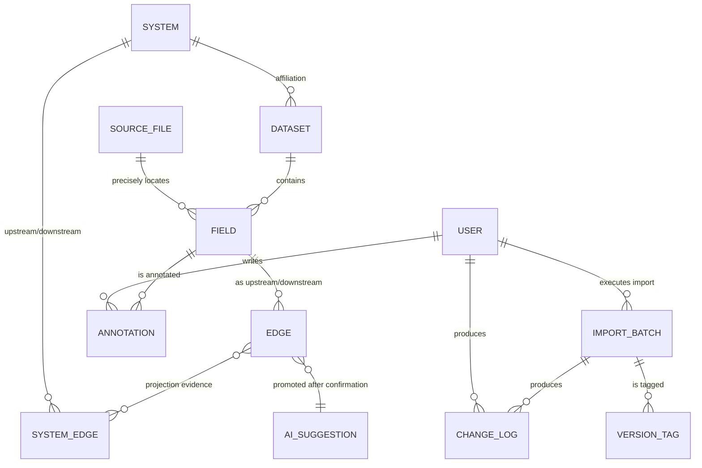

# Clew Business Model

> Business-layer model extracted from "clew-design-proposal.md", describing "what we do, for whom, which concepts it runs on, and which rules constrain it"; technical implementation (table structures, API, frontend) is in the design doc and not repeated here.

---

## 1. Business Positioning and Value Proposition

**One-line positioning**: a data lineage verification and collaboration tool for small teams—users import curated second-hand data (CSV/XLSX/JSON) into the system, which presents the data's provenance as a field-level lineage graph and guarantees that **every field can be traced back to its exact location in the first-hand source file with one click**.

| Value proposition | Description |
|---|---|
| **Traceable to source** | Every field carries an exact source-file locator (worksheet/header path/column/row range/JSONPath); first-hand files are hosted by the system and can be previewed and verified online |
| **Trustworthy** | Validation on import (including real-file verification against source files), versioned management, full audit trails, and separation of manual corrections from AI suggestions |
| **Lightweight** | Single process + single relational database, no message queue/search cluster, operable by one person |
| **Architectural view** | Once datasets are assigned to systems, inter-system upstream/downstream relations can be viewed on the same canvas; system edges are either auto-projected from dataset-level lineage or explicitly registered, and can be drilled down to the underlying evidence |
| **AI enhancement** | Query lineage in natural language and generate graphs dynamically; AI can also propose missing lineage in reverse, but it takes effect only after manual confirmation |

**Business premise**: the data users import is second-hand data that they have transformed and curated from actual data, not first-hand material; first-hand material is hosted separately as source files. The system's core responsibility is to keep "second-hand lineage" verifiable against "first-hand material" at all times.

---

## 2. Stakeholders and Roles

| Business role | System role | Main business activities |
|---|---|---|
| Data viewer (someone who consumes lineage information) | `viewer` | Browse lineage graphs, view field details, source preview, AI read-only Q&A |
| Lineage maintainer (someone who curates/imports/corrects) | `editor` | Upload source files, import manifests, make corrections, draw edges by dragging, add annotations, apply version tags, confirm AI suggestions |
| System administrator | `admin` | User and role management, rollback, dataset deletion |

The permission model is workspace-level RBAC: all datasets in the workspace are visible to all users; no object-level authorization (reserved for future extension).

---

## 3. Core Business Concepts (Domain Glossary)

| Concept | Business meaning | Key business attributes |
|---|---|---|
| **Dataset** | A node in the lineage graph, the logical unit of the user's business data | Identifier (user-defined id), display name, description, owning system (nullable) |
| **System** | An optional affiliation layer above datasets, representing a business system/application/data warehouse/reporting platform | Identifier (user-defined id), display name, type (source system/application/data warehouse/BI/external/other), owner, description |
| **System-Level Lineage (System Edge)** | Upstream/downstream relations between systems | Upstream system, downstream system, interface/processing description, confidence, source (imported/manual/ai), note; may come from dataset-level lineage projection or be explicitly registered |
| **Field** | A field within a dataset, the smallest unit of lineage tracing | Owning dataset, field name, type, description |
| **Source File** | First-hand material hosted by the system | Original file name, type (csv/xlsx/json), uploader; identical content is stored once (deduplicated by content fingerprint) |
| **Source Locator** | Exact location of a field within the source file, the basis for source verification | csv = column number/header; xlsx = worksheet + column + row range, supporting multi-level header paths and merged-cell anchor normalization; json = JSONPath |
| **Lineage Edge** | Upstream → downstream data provenance relation, either table-level or field-level | Upstream field, downstream field, transform description, confidence, lineage source (imported/manual/ai), note |
| **Transform** | Description of how upstream data is processed into downstream (SQL fragment/formula/text) | Attached to the edge, for understanding rather than execution |
| **Confidence** | A measure of how reliable the lineage is (0–1) | AI-inferred edges default to low confidence |
| **Import Batch** | One file import = one version (v1, v2…) | Version number, imported files, import report, actor |
| **Version Tag** | A business-level release marker (e.g. `v2.1-r1 / Q3 metric-definition fix release`) | Tag name, description, anchored change position, creator |
| **Annotation** | Business notes appended to a dataset/field/edge to help others understand meaning and usage | Target object, content, author, time; **append-only, never overwrites imported original values** |
| **Change Log** | Before/after record of every data change | Operation type (add/update/delete), before value, after value, actor; the basis for version rollback and comparison |
| **AI Lineage Suggestion** | Lineage that AI proactively proposes as possibly missing | Low confidence, source marked as ai; **requires manual confirmation** before becoming formal lineage |

---

## 4. Concept Relationships

The most important relationship chain in the business: **field → (source locator) → source file**. It lets "any field in the lineage graph" be traced back to a specific location in the first-hand material for verification—this is the core business difference between this solution and OpenMetadata/DataHub (neither of their field models has file-level locators).

---

## 5. Core Business Flows

### 5.1 Data Hosting and Import (Data Entering the System)
1. Upload first-hand source files → the system registers them in the file library (deduplicated by content);
2. Submit an import manifest (dataset list + lineage relations; CSV as two files / XLSX as two sheets / JSON as a single file);
3. System validation: structural validation → **open the source file and verify locators against the real file** → referential validation → conflict merge;
4. Generate an import report (per-item success/failure and reason); everything is stored as a new version batch, and the change log is written at the same time.

### 5.2 Source Verification (Validate Field Correctness)
Click any field in the lineage graph → a locator card pops up (source file name + human-readable locator) → click preview → the system highlights the corresponding region of the source file in place (header path/column/row range/JSONPath hit values). Verifiers do not need to leave the system to find the original file.

### 5.3 Lineage Correction (Maintainers Fix Based on First-Hand Material)
When an incorrect node/field/edge is found → edit on the canvas: change the field locator, change the description, delete wrong edges, drag field connections to create new edges → every change is audited (who, when, what changed, before/after values).

### 5.4 Collaborative Understanding (Annotations)
Append notes (meaning, metric definition, usage, pitfalls) to any dataset/field/edge; records are append-only, writable by multiple people, and permanently audited; imported raw data and human insights are stored separately.

### 5.5 AI-Assisted Query (Quickly Locate Upstream/Downstream)
Ask in natural language (e.g. "Where does order_no in the order table come from") → AI calls system query tools to trace upstream/downstream → textual answer + the canvas automatically switches to the corresponding lineage subgraph. All rendering goes through a unified rendering protocol.

### 5.6 AI Reverse Enhancement (Suggest Missing Lineage)
AI proposes possibly missing lineage edges based on field names/descriptions/semantic similarity → presented as "low-confidence, source=ai" candidates → the user confirms or rejects them on the graph → only confirmed candidates become formal lineage.

### 5.7 Version Management and Rollback (Trustworthy Evolution)
Imports create new version batches; business version tags can be applied at any time; supports rollback by batch, rollback by tag, and diff between any two versions/tags. Rollback never loses manual annotations.

### 5.8 System-Level Upstream/Downstream View (Architectural Perspective)
Maintainers assign datasets to systems (or include `system_id` in the import manifest) → the system-level view automatically projects dataset-level lineage into inter-system upstream/downstream relations → coarse-grained interfaces that cannot be derived from datasets (e.g. "finance system → data warehouse: monthly reconciliation file") can be registered explicitly → viewers drill down from the system graph to datasets/fields and check the specific lineage evidence contributing to that edge. System-level relations do not require dataset-level evidence, but once marked as "projected/both", the underlying dataset edges must be listable.

---

## 6. Business Rules and Invariants

The following are business constraints the system must maintain (the technical design implements them):

1. **No locator, no storage**: every field must reference a hosted source file and carry a source locator that passed real-file verification; fields failing verification are rejected on import.
2. **Locator normalization**: merged cells always normalize to the top-left anchor (with the merged range recorded); multi-level headers are matched by expanding the header path level by level; parse results are stored materialized.
3. **Edge uniqueness**: only one lineage edge exists per "upstream → downstream" field pair in the system.
4. **AI cannot take effect directly**: AI-inferred lineage always exists first as a low-confidence candidate and becomes formal only after manual confirmation (editor or above).
5. **Annotations are append-only**: annotations are append-only records that do not modify or overwrite imported raw data.
6. **Every write is audited**: all write operations—import, edit, annotation, tagging, rollback—record the actor and before/after values (the role comes from the login identity and cannot be forged).
7. **Versions are revertible**: any change can be reverted through the change log—rollback works by batch and by business tag; tags can be diffed.
8. **Tiered permissions**: viewer is read-only, editor can write business data, admin manages the system; file download and preview are permission-controlled, and storage paths are not exposed externally.
9. **Keys never enter the database**: AI provider keys exist only in the deployment environment's `.env` and never enter the code repository.
10. **System edges are explainable**: system-level relations must be labeled with their origin (explicit/projected/both); projected edges must be able to list the underlying dataset edge count and list; aggregated system-level cycles are allowed but must be flagged without blocking queries.
11. **System affiliation is optional**: datasets may belong to no system; unaffiliated datasets do not enter the system graph and cannot be fabricated as virtual system nodes.

---

## 7. Business Object Lifecycles

| Object | Lifecycle |
|---|---|
| Source file | Registered on upload → referenced by fields (possibly many times/by many people) → retained long-term for source preview |
| System | Created/registered on import → datasets assigned → searched/drilled down in the system graph → affiliation removed on deletion (datasets retained) |
| System-level lineage | Appears automatically via dataset-edge projection / explicitly registered / promoted after AI suggestion confirmation → viewed and drilled down for evidence → disappears or is restored with version rollback |
| Field | Created on import → real-file verification → browsed/traced → corrected (locator/description changes) → annotated → disappears or is restored with version rollback |
| Lineage edge | Created on import / created manually / promoted after AI suggestion confirmation → traced and corrected → disappears or is restored with version rollback |
| Version | Each import is a new version → business tags applied → diff between tags / rollback |
| Annotation | Written → appended permanently (not deleted on rollback) |
