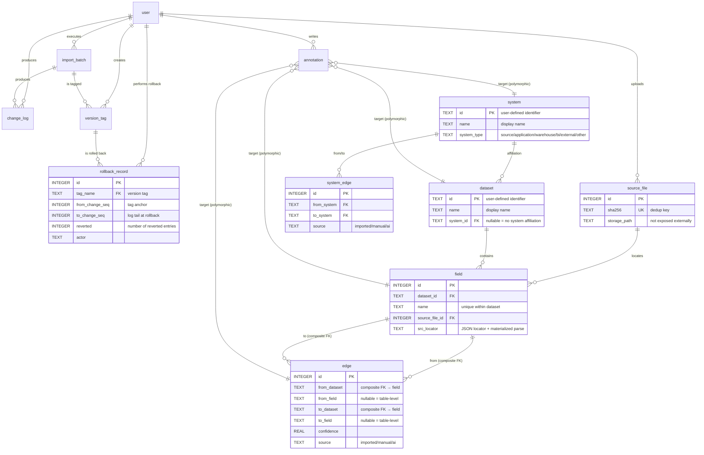

# Clew Data Model

> The data-layer implementation model corresponding to "clew-business-model.md", refined from Chapter 4 of "clew-design-proposal.md". **Since 2026-11 this is a dual-database model**: SQLite (§1–9) is the single source of truth (the dialect is based on SQLite with a reserved Postgres upgrade path; divergences are marked); Kùzu 0.11.3 handles lineage topology traversal (§10, derived layer, rebuildable in full from SQLite at any time).
>
> **2026-11 system-level lineage extension (design finalized, code pending)**: adds the `system` catalog and `system_edge` explicit edges, with `dataset.system_id` recording affiliation; system-level relations are merged from "explicit edges ∪ dataset-edge projections" into `v_system_edge` and projected to Kùzu `System` nodes and `LINEAGE_SYSTEM` relations. System attributes/search live in SQLite; system-level path traversal lives in Kùzu, following the same layering (design doc §4.7).

---

## 1. Model Overview

Core idea: **the "current state" consists of three classes of definitions—13 base tables, "derived views", and "JSON structures"—plus one single-row sync-status table, `graph_state` (§2.12, added by the 2026-11 dual-database plan)**. The current state is the latest business state (the primary read/write path); history and versions are reconstructed from the append-only `change_log` (the basis for rollback/diff), with no full snapshots. The 10th table, `rollback_record`, is the M3 **rollback-by-tag audit** (rollback itself does not write change_log; see §7); the 11th table, `description_draft`, is the M5 AI description-draft workspace; `graph_state` records the sync status between the Kùzu derived graph and the main database (§10); the 12th/13th tables, `system` / `system_edge`, are the **system catalog and explicit system edges** added by the 2026-11 system-level lineage work (§2.13/§2.14).



> Note: `edge` is a self-referential many-to-many relation on field (field-level lineage); `from_field`/`to_field` being NULL indicates table-level lineage. `annotation` is a polymorphic association (`target_kind` + `target_id`), drawn as three dashed connectors in the diagram.

---

## 2. Table Definitions

### 2.1 user (User)

| Column | Type | Constraint | Description |
|---|---|---|---|
| id | INTEGER | PK AUTOINCREMENT | |
| username | TEXT | UNIQUE NOT NULL | Login name |
| password_hash | TEXT | NOT NULL | Salted hash, never plaintext |
| display_name | TEXT | | Display name |
| role | TEXT | NOT NULL CHECK(IN('admin','editor','viewer')) | RBAC role |
| created_at | TEXT | NOT NULL | ISO8601 UTC (SQLite stores everything as TEXT) |

### 2.2 source_file (Source File Hosting, First-Hand Material File Library)

| Column | Type | Constraint | Description |
|---|---|---|---|
| id | INTEGER | PK AUTOINCREMENT | File library ID; referenced by `src_file` in the import manifest |
| original_name | TEXT | NOT NULL | Original file name (retained for display) |
| storage_path | TEXT | NOT NULL | Actual storage path (defaults to local `data/files/`), **not exposed externally**; access goes through a controlled API |
| sha256 | TEXT | UNIQUE NOT NULL | Content fingerprint and dedup key: re-uploading identical content reuses the same record |
| size_bytes | INTEGER | | |
| src_type | TEXT | NOT NULL CHECK(IN('csv','xlsx','json')) | Determines the locator structure and the real-file verification method |
| uploaded_by | TEXT | NOT NULL REFERENCES user(username) | |
| created_at | TEXT | NOT NULL | |

### 2.3 dataset (Dataset, Lineage Node)

| Column | Type | Constraint | Description |
|---|---|---|---|
| id | TEXT | PK | User-defined identifier (the `dataset_id` in the import manifest) |
| name | TEXT | | Display name |
| description | TEXT | | |
| system_id | TEXT | NULL, REFERENCES system(id) ON DELETE SET NULL | Owning system (added by 2026-11 system-level lineage); NULL = no system affiliation, excluded from the system graph |
| created_at / updated_at | TEXT | NOT NULL | |

### 2.4 field (Field, Minimum Unit of Lineage Tracing)

| Column | Type | Constraint | Description |
|---|---|---|---|
| id | INTEGER | PK AUTOINCREMENT | Surrogate key for canvas/program references |
| dataset_id | TEXT | NOT NULL REFERENCES dataset(id) | |
| name | TEXT | NOT NULL | |
| field_type | TEXT | | Free-text type description |
| source_file_id | INTEGER | NOT NULL REFERENCES source_file(id) | Every field must reference a hosted source file (invariant #1) |
| src_locator | TEXT | NOT NULL | JSON: locator + materialized result of real-file parsing (see 4.1) |
| description | TEXT | | Original description from import (human insights go to annotation, not this column) |
| created_at / updated_at | TEXT | NOT NULL | |

**Unique constraint**: `UNIQUE(dataset_id, name)` — the field natural key and the reference target of the edge table's composite FK.

### 2.5 edge (Lineage Edge, Unified Table-Level + Field-Level)

| Column | Type | Constraint | Description |
|---|---|---|---|
| id | INTEGER | PK AUTOINCREMENT | |
| from_dataset | TEXT | NOT NULL, composite FK → field(dataset_id, name) (see below) | Upstream dataset |
| from_field | TEXT | NULL = table-level edge | Upstream field |
| to_dataset | TEXT | NOT NULL, composite FK as above | Downstream dataset |
| to_field | TEXT | NULL = table-level edge | Downstream field |
| transform | TEXT | | Transform description (SQL fragment/formula/text), for understanding only, never executed |
| confidence | REAL | DEFAULT 1.0, CHECK(0≤x≤1) | Confidence; AI edges < 1.0 |
| source | TEXT | NOT NULL CHECK(IN('imported','manual','ai')) | Lineage source |
| note | TEXT | | |
| created_by / updated_by | TEXT | REFERENCES user(username) | Operator audit trail |
| created_at / updated_at | TEXT | NOT NULL | |

**Unique constraint (natural key)**: only one edge is allowed per upstream/downstream pair (invariant #3). Note: for combinations containing NULL, SQLite's UNIQUE uses `NULLS DISTINCT` semantics (any two NULLs are unequal), so table-level edges (both from_field/to_field NULL) cannot be caught by `UNIQUE(from_dataset, from_field, to_dataset, to_field)`. The M1 implementation instead uses two partial unique indexes to enforce this invariant (see the DDL in `src/clew/db.py`):
- Field-level edge: `CREATE UNIQUE INDEX uq_edge_field ON edge(from_dataset, from_field, to_dataset, to_field) WHERE from_field IS NOT NULL AND to_field IS NOT NULL;`
- Table-level edge: `CREATE UNIQUE INDEX uq_edge_table ON edge(from_dataset, to_dataset) WHERE from_field IS NULL AND to_field IS NULL;`

**Composite foreign key**: `(from_dataset, from_field) REFERENCES field(dataset_id, name)`, `(to_dataset, to_field) REFERENCES field(dataset_id, name)`. NULL members are allowed by default (MATCH SIMPLE), consistent with the "table-level edge" semantics.

### 2.6 import_batch (Import Batch = Version)

| Column | Type | Constraint | Description |
|---|---|---|---|
| id | INTEGER | PK AUTOINCREMENT | |
| version_no | INTEGER | UNIQUE NOT NULL | Incrementing version number, v1, v2… |
| file_names | TEXT | | Manifest file names in this batch (JSON array) |
| format | TEXT | NOT NULL CHECK(IN('csv','xlsx','json')) | Manifest physical format |
| report | TEXT | | Import report JSON (see 4.3), downloadable |
| created_by | TEXT | NOT NULL REFERENCES user(username) | |
| created_at | TEXT | NOT NULL | |
| rolled_back_at | TEXT | | Rollback time; written when a batch rollback or a tag rollback reverts this batch |
| rolled_back_by | TEXT | REFERENCES user(username) | Rollback actor |

### 2.7 version_tag (Business Version Tag)

| Column | Type | Constraint | Description |
|---|---|---|---|
| id | INTEGER | PK AUTOINCREMENT | |
| name | TEXT | UNIQUE NOT NULL | Business tag name (e.g. `v2.1-r1`) |
| note | TEXT | | Tag description (e.g. "Q3 metric-definition fix release") |
| batch_id | INTEGER | REFERENCES import_batch(id) | Most recent batch at tagging time (informational; rollback does not depend on it) |
| change_seq | INTEGER | NOT NULL | Anchored change_log position; rolling back to the tag = revert all changes after this seq |
| created_by | TEXT | NOT NULL REFERENCES user(username) | |
| created_at | TEXT | NOT NULL | |

**Audit note (M3)**: tag creation is traced via `created_by/created_at` and **does not write `change_log`**—otherwise "rolling back to an earlier tag" would treat the tag itself as revertible data and delete it, violating the business rule "tags are retained permanently". Tag names are unique; creating a duplicate returns 409.

### 2.8 annotation (Annotation, Append-Only Business Notes)

| Column | Type | Constraint | Description |
|---|---|---|---|
| id | INTEGER | PK AUTOINCREMENT | |
| target_kind | TEXT | NOT NULL CHECK(IN('dataset','field','edge','system','system_edge')) | Polymorphic association type (system/system_edge added in 2026-11) |
| target_id | TEXT | NOT NULL | See 5.2 for the naming convention; **no foreign key** (polymorphic); the application layer validates that the target exists |
| body | TEXT | NOT NULL | Annotation content |
| author | TEXT | NOT NULL REFERENCES user(username) | Taken from the JWT; cannot be forged |
| created_at | TEXT | NOT NULL | Append-only (invariant #5); no updated_at |

### 2.9 change_log (Change Log, Basis for Version Reconstruction)

| Column | Type | Constraint | Description |
|---|---|---|---|
| id | INTEGER | PK AUTOINCREMENT | This is the globally incrementing `change_seq` |
| batch_id | INTEGER | NULL = manual edit, REFERENCES import_batch(id) | |
| entity_kind | TEXT | NOT NULL CHECK(IN('dataset','field','edge','system','system_edge','graph')) | Changed object type (system/system_edge added in 2026-11; graph records graph rebuilds and does not participate in reverts) |
| entity_key | TEXT | NOT NULL | See 5.2 for the naming convention |
| op | TEXT | NOT NULL CHECK(IN('added','updated','deleted')) | |
| before | TEXT | NULL (empty for added) | JSON snapshot before the change |
| after | TEXT | NULL (empty for deleted) | JSON snapshot after the change |
| actor | TEXT | NOT NULL REFERENCES user(username) | |
| created_at | TEXT | NOT NULL | |

### 2.10 rollback_record (Rollback-by-Tag Audit, Added in M3)

| Column | Type | Constraint | Description |
|---|---|---|---|
| id | INTEGER | PK AUTOINCREMENT | |
| tag_name | TEXT | NOT NULL REFERENCES version_tag(name) | Business tag rolled back to |
| from_change_seq | INTEGER | NOT NULL | change_seq anchored by the tag (range start, exclusive) |
| to_change_seq | INTEGER | NOT NULL | Maximum change_log id at rollback time (range end, inclusive) |
| reverted | INTEGER | NOT NULL | Number of log entries reverted in this run |
| actor | TEXT | NOT NULL REFERENCES user(username) | Administrator who performed the rollback |
| created_at | TEXT | NOT NULL | |

**Why a separate table**: if rollback operations wrote `change_log`, the next rollback would revert the "rollback log" again, breaking rollback-safety-on-repeat; `change_log` must also keep the clean semantics of "revertible business changes" (`graph` rebuild records do not participate in reverts). Rollback audits therefore live in `rollback_record`, satisfying "every write is audited" without polluting the version-revert boundary.

### 2.11 description_draft (AI Description Draft, Added in M5)

Workspace for AI-generated descriptions: drafts **do not touch** `field.description` (the original imported value); only after the user accepts in the UI is an `annotation` written (append-only business note); rejected fields are not regenerated.

| Column | Type | Constraint | Description |
|---|---|---|---|
| id | INTEGER | PK AUTOINCREMENT | |
| dataset_id | TEXT | NOT NULL REFERENCES dataset(id) | |
| field_name | TEXT | NOT NULL; FK `field(dataset_id, name)`, cascade delete/update | Target field of the draft |
| draft | TEXT | NOT NULL, 1–400 characters | AI-generated description draft |
| model | TEXT | NOT NULL | Model name used for generation (audit) |
| status | TEXT | NOT NULL CHECK IN ('pending','accepted','rejected'), DEFAULT 'pending' | Lifecycle |
| created_at | TEXT | NOT NULL | |
| decided_at | TEXT | nullable | Acceptance/rejection time |

Unique constraint `(dataset_id, field_name, status)`: a field has only one pending draft at a time; accepted/rejected history can coexist as an audit trail. This table is an AI workspace and **does not write change_log** (business traces land in annotation upon acceptance). For design and flow see [03_dev/07_ai-module-evolution-plan](../03_dev/07_ai-module-evolution-plan.md) §4.5.

### 2.12 graph_state (Kùzu Derived Graph Sync Status, Added by the 2026-11 Dual-Database Plan)

Single-row table (always `id=1`) recording the sync watermark and status between the Kùzu lineage graph (§10) and the main database. Under the "SQLite is the single source of truth" principle it is the **dual-database coordinator**: the criteria for marking dirty on graph-write failure, pre-read checks, and automatic rebuild all come from this row.

| Column | Type | Constraint | Description |
|---|---|---|---|
| id | INTEGER | PK, CHECK(id=1) | Always 1 |
| last_edge_id | INTEGER | NOT NULL DEFAULT 0 | `edge.id` watermark already synced to Kùzu (used to decide incremental vs. full rebuild; M2 uses full rebuild) |
| state | TEXT | NOT NULL CHECK(IN('clean','dirty','rebuilding')), DEFAULT 'clean' | clean = graph is trustworthy; dirty = graph needs rebuild (the read path attempts automatic rebuild → falls back to CTE on failure); rebuilding = rebuild in progress |
| node_count | INTEGER | | Graph node count after the latest rebuild (for display/audit; includes System/Dataset/Field nodes) |
| rel_count | INTEGER | | Graph edge count after the latest rebuild (reconciled against the total of SQLite `edge` + `v_system_edge`) |
| system_rel_count | INTEGER | | System-level relation count after the latest rebuild (reconciled against `SELECT COUNT(*) FROM v_system_edge`; added 2026-11) |
| rebuilt_at | TEXT | | Completion time of the latest rebuild |
| rebuilt_by | TEXT | REFERENCES user(username) | Rebuild initiator (auto = automatic, or the admin username) |

> The single-row constraint is enforced by the application layer (INSERT OR IGNORE + fixed id=1). `rel_count/node_count` enable **cheap reconciliation**: after each import, `rel_count` is compared with the main database's edge count, and any mismatch marks the graph dirty; the full `clew graph audit` then performs an exact edge_id set comparison (§10).

### 2.13 system (System Catalog, Added by 2026-11 System-Level Lineage)

Systems are an **optional** affiliation layer above datasets, used to show upstream/downstream relations between systems. Attributes and entry-point search all live in SQLite; system-level path traversal is handled by Kùzu `System` nodes (§10).

| Column | Type | Constraint | Description |
|---|---|---|---|
| id | TEXT | PK | User-defined system identifier (e.g. `crm` / `dw_platform`) |
| name | TEXT | | Display name |
| description | TEXT | | System description |
| system_type | TEXT | NOT NULL DEFAULT 'other', CHECK(IN('source','application','warehouse','bi','external','other')) | System type; determines canvas icon/color and filtering |
| owner | TEXT | | Business owner (free text; not used for authorization) |
| created_at / updated_at | TEXT | NOT NULL | |

**Unique constraint**: `id` is the primary key; `name` is not required to be unique (different teams may have systems with the same name; the identifier is the key).

### 2.14 system_edge (Explicit System-Level Lineage, Added by 2026-11 System-Level Lineage)

Records only coarse-grained system relations **that cannot be derived from dataset-level lineage** (e.g. "finance system → data warehouse: monthly reconciliation Excel"). Relations that can be projected from `edge` + `dataset.system_id` are not stored in this table; they are merged at query time by `v_system_edge` (§3.3).

| Column | Type | Constraint | Description |
|---|---|---|---|
| id | INTEGER | PK AUTOINCREMENT | Explicit-edge primary key, used to locate the edge for edit/delete/AI promotion |
| from_system | TEXT | NOT NULL REFERENCES system(id) | Upstream system |
| to_system | TEXT | NOT NULL REFERENCES system(id) | Downstream system |
| transform | TEXT | | Interface/processing description (e.g. "T+1 batch files", "Kafka real-time sync") |
| confidence | REAL | DEFAULT 1.0, CHECK(0≤x≤1) | Confidence; AI candidates < 1.0 |
| source | TEXT | NOT NULL CHECK(IN('imported','manual','ai')) | Source; AI candidates must be manually confirmed and then switched to `manual` |
| note | TEXT | | Note |
| created_by / updated_by | TEXT | REFERENCES user(username) | Operator audit trail |
| created_at / updated_at | TEXT | NOT NULL | |

**Unique constraint**: `UNIQUE(from_system, to_system)` (only one explicit edge per upstream/downstream system pair; the system-level extension of invariant #3); `CHECK(from_system <> to_system)` forbids self-loops.

**Why derived edges are not stored**: projected edges are a derived result of `edge` + `dataset.system_id`; persisting them would introduce dual-write drift ("dataset edge changed, system edge not updated"). Merging in real time via `v_system_edge` at query time suffices. Explicit edges are persisted because they carry business information that projections cannot express and must participate in versioning and rollback.

---

## 3. Derived Views

### 3.1 v_dataset_edge (Table-Level Lineage, Derived and Not Persisted)

Field-level edges automatically derive table-level edges; standalone table-level edges (fields NULL) are preserved as-is:

```sql
CREATE VIEW v_dataset_edge AS
SELECT DISTINCT from_dataset, to_dataset FROM edge
UNION
SELECT from_dataset, to_dataset FROM edge
WHERE from_field IS NULL AND to_field IS NULL;
```

> Design rationale: avoid the consistency problems of OpenMetadata-style "two edge stores with dual writes"—table-level relations are always a projection of field-level relations.

### 3.2 Field Search (Supporting the search_fields Tool)

The M4 implementation **does not introduce an FTS5 virtual table**; `search_fields` (`prototype/backend/src/lineagelite/ai/tools.py`) uses SQLite `LIKE` fuzzy matching directly against `field` / `dataset` / `annotation`:

```sql
-- Actual implementation (simplified): dataset id/name, field name, field description, field annotation
SELECT ... FROM field f JOIN dataset d ON d.id = f.dataset_id
WHERE lower(f.dataset_id) LIKE :pattern
   OR lower(COALESCE(d.name, '')) LIKE :pattern
   OR lower(f.name) LIKE :pattern
   OR lower(COALESCE(f.description, '')) LIKE :pattern
   OR EXISTS (SELECT 1 FROM annotation a
              WHERE a.target_kind = 'field'
                AND a.target_id = f.dataset_id || '.' || f.name
                AND lower(a.body) LIKE :pattern)
ORDER BY CASE
           WHEN lower(f.name) = :exact THEN 0
           WHEN lower(f.name) LIKE :prefix THEN 1
           ELSE 2
         END,
         f.dataset_id, f.name
LIMIT 20;
```

**Trade-off**: at the current data scale (small team, single-node SQLite), a full-table `LIKE` scan is sufficient; FTS5 requires triggers or application-layer dual writes to maintain, and M4 did not introduce it, so `field_fts` is not created. If data volume grows, FTS5 can be introduced, or after migrating to Postgres, `tsvector` + GIN indexes can be used; the `search_fields` interface and ranking semantics remain unchanged.

### 3.3 v_system_edge (System-Level Relations: Explicit ∪ Projected, Added 2026-11)

There are two sources of system-level relations, merged into one view at query time, **not materialized and not dual-written**:

1. **explicit**: explicit system edges registered in `system_edge`;
2. **derived**: map the datasets at both ends of each `edge` to systems via `dataset.system_id`, counting distinct "dataset pairs"; dataset edges within the same system are excluded (producing no self-loops);
3. **both**: the same system pair has both an explicit edge and projected edges; the explicit edge's business attributes take precedence, and the projection only contributes the `dataset_edge_count` evidence count.

```sql
CREATE VIEW v_system_edge AS
WITH derived AS (
  SELECT d_from.system_id AS from_system,
         d_to.system_id   AS to_system,
         COUNT(DISTINCT e.from_dataset || '->' || e.to_dataset) AS dataset_edge_count,
         MIN(e.confidence) AS confidence
  FROM edge e
  JOIN dataset d_from ON d_from.id = e.from_dataset
  JOIN dataset d_to   ON d_to.id   = e.to_dataset
  WHERE d_from.system_id IS NOT NULL
    AND d_to.system_id IS NOT NULL
    AND d_from.system_id <> d_to.system_id
  GROUP BY d_from.system_id, d_to.system_id
),
explicit AS (
  SELECT id, from_system, to_system, transform, confidence, source, note
  FROM system_edge
)
SELECT e.from_system, e.to_system,
       CASE WHEN d.from_system IS NOT NULL THEN 'both' ELSE 'explicit' END AS origin,
       COALESCE(d.dataset_edge_count, 0) AS dataset_edge_count,
       e.id AS system_edge_id,
       e.transform, e.confidence, e.source, e.note
FROM explicit e
LEFT JOIN derived d ON d.from_system = e.from_system AND d.to_system = e.to_system
UNION ALL
SELECT d.from_system, d.to_system, 'derived', d.dataset_edge_count,
       NULL, NULL, d.confidence, 'derived', NULL
FROM derived d
LEFT JOIN explicit e ON e.from_system = d.from_system AND e.to_system = d.to_system
WHERE e.id IS NULL;
```

**Column semantics**:

| Column | Description |
|---|---|
| `origin` | `explicit` / `derived` / `both`; the UI must display it so that system edges remain explainable |
| `dataset_edge_count` | Number of dataset-level edges contributing to this edge (deduplicated by `from_dataset→to_dataset`); 0 for pure explicit edges |
| `system_edge_id` | Explicit-edge primary key; NULL for pure projected edges |
| `confidence` | For explicit edges, `system_edge.confidence`; for pure projected edges, the minimum of the underlying edges |
| `source` | For explicit edges, `system_edge.source`; for pure projected edges, always `derived` |

**Implementation notes**:

- `COUNT(DISTINCT e.from_dataset || '->' || e.to_dataset)` relies on identifiers not containing `->`; if arbitrary characters are allowed in the future, switch to a subquery that groups and counts by `(from_dataset,to_dataset)`;
- The view does not participate in `change_log` reverts; after a rollback, `graph_state` is marked dirty to trigger a Kùzu rebuild;
- Changing a dataset's affiliation (`dataset.system_id`) immediately changes the projection results; no system edge table needs maintenance.

---

## 4. JSON Structure Definitions (Stored in TEXT Columns, Validated by pydantic on Import)

### 4.1 field.src_locator (Source File Locator + Materialized Parse Result)

Unified envelope: `{ "type": <src_type>, "input": <user input>, "resolved": <materialized real-file parse> }`

```jsonc
// type = csv
{ "type": "csv",
  "input":  { "column": 3 }                       // or { "header": "order_no" }
, "resolved": { "column_index": 3, "header": "order_no" } }

// type = xlsx (simple column locator)
{ "type": "xlsx",
  "input":  { "sheet": "Order Details", "column": "D", "row_start": 2, "row_end": 15000 }
, "resolved": { "column_index": 4, "column": "D",
                "row_start": 2, "row_end": 15000, "merged_anchors": [] } }

// type = xlsx (multi-level headers + merged cells)
{ "type": "xlsx",
  "input":  { "sheet": "Orders", "header_path": ["Product Info", "Order No"], "header_rows": 2, "row_start": 3 }
, "resolved": { "column_index": 4, "column": "D",
                "row_start": 3, "row_end": null,
                "merged_anchors": [ { "value": "Product Info", "anchor": "B1", "range": "B1:F1" } ] } }
// Normalization rule: any locator falling inside a merged region is materialized as the top-left anchor plus the merged range

// type = json
{ "type": "json",
  "input":  { "json_path": "$.data.items[*].order_no" }
, "resolved": { "hits": 3 } }   // number of JSONPath hits found by real-file verification
```

**Implementation note**: `resolved` materializes only parse results (`column_index` / `column` / `row_start` / `row_end` / `merged_anchors` / `hits`) and **does not write `verified_at`**; the batch, actor, and time of verification are traced by `import_batch` / `change_log`, and `verification` in the source-preview response (§9.1) returns the version number, actor, and time of the most recent import that passed real-file verification.

**Invariant**: `resolved` is written by the importer after parsing the hosted source file (openpyxl/standard-library json); `input` retains the user's original input for review and failure diagnosis. `type` must match the owning source_file's `src_type` (validated by the application layer).

**M3 manual locator correction**: when `PATCH /fields/{dataset_id}/{field_name}` supplies `src_locator`, it must **re-run structural validation + real-file verification** and rewrite the entire envelope (`resolved` is re-materialized, not reused); on verification failure it returns 409 and the field keeps its original value. The request may pass the locator `input`, or a complete envelope (`resolved` is ignored and recomputed).

### 4.2 change_log.before / after (Row Snapshots)

The **fixed business-column set** of the target row (`FIELD_SNAPSHOT_KEYS` / `EDGE_SNAPSHOT_KEYS` in `prototype/backend/src/lineagelite/changes.py`), excluding `id`, timestamps, and the `created_by/updated_by` audit columns:

- field: `dataset_id, name, field_type, source_file_id, src_locator, description`
- edge: `from_dataset, from_field, to_dataset, to_field, transform, confidence, source, note`
- dataset (added by 2026-11 system-level lineage): `id, name, description, system_id`
- system (added 2026-11): `id, name, description, system_type, owner`
- system_edge (added 2026-11): `from_system, to_system, transform, confidence, source, note`

The added / updated / deleted snapshots of the same entity use the same key set, so `before` and `after` are directly comparable; the `before` of a deleted row can be reinserted wholesale (the rollback implementation). Audit columns are restored separately on reinsert (`versioning.py`: prefer the actor of the most recent `added` log for that natural key before the current `deleted` log; if absent, use the rollback actor; `updated_by` is set to the rollback actor).

### 4.3 import_batch.report (Import Report)

```jsonc
{ "summary": { "total": 120, "ok": 100, "merged": 8, "rejected": 12 },
  "items": [ { "status": "ok|merged|rejected", "kind": "field|edge|system|system_edge",
               "ref": "ods_raw.order_id", "reason": "…",            // required for rejected
               "source_row": 15 } ] }                                // original row number in the manifest
```

> Since 2026-11, `kind` includes `system` / `system_edge`; legacy manifests never produce these two entry kinds, so the report structure is backward compatible.

---

## 5. Identifiers and Naming Conventions

### 5.1 Natural Key Summary

| Entity | Natural key | Description |
|---|---|---|
| dataset | `id` (user-defined string) | Nullable `system_id` records affiliation |
| system | `id` (user-defined string) | Added 2026-11 |
| system_edge | `(from_system, to_system)` | Unique per upstream/downstream system pair; self-loops forbidden |
| field | `(dataset_id, name)` | Target of the edge table's composite FK |
| edge | `(from_dataset, from_field, to_dataset, to_field)` | Unique per pair (invariant #3) |
| source_file | `sha256` | Content dedup |
| import_batch | `version_no` | Version number |
| version_tag | `name` | Business tag name |
| user | `username` | Referenced by created_by/actor/author in each table |

### 5.2 Polymorphic/Log entity_key Naming Conventions (Enforced by the Application Layer)

| Object | entity_key / target_id format | Example |
|---|---|---|
| dataset | `<dataset_id>` | `ods_raw` |
| system | `<system_id>` | `dw_platform` |
| system_edge | `<from_system>--><to_system>` | `crm-->dw_platform` |
| graph | `graph` | `graph` (rebuild audit trail; does not participate in reverts) |
| field | `<dataset_id>.<field_name>` | `ods_raw.order_id` |
| edge | `<from>--><to>` (use `*` for empty fields) | `ods_raw.order_id-->dwd_order.order_no`, `ods_raw.*-->dwd_order.*` |

> For table-level edges, the M3 annotation API additionally accepts the shorthand `ds-->ds` with `.*` omitted; target existence is validated by the application layer (dataset against dataset, field against the composite natural key, edge against the four-part natural key); a missing target returns 404, and an invalid format returns 400. A `field` target tries every dot position and takes the uniquely existing field, so names containing dots are still resolvable (multiple matches return 400); each side of an `edge` target is split at the rightmost dot, which is safest when field names themselves contain no dots.

### 5.3 Referential Integrity Notes

`edge` achieves database-level integrity via composite foreign keys; target references in `annotation` and `change_log` use **application-layer validation** (polymorphism cannot be expressed with FKs), and traceability is ensured by "validate target existence before write + record the key after write".

---

## 6. Index Strategy

| Table | Index | Purpose |
|---|---|---|
| edge | `uq_edge_field` partial unique index: `(from_dataset, from_field, to_dataset, to_field) WHERE from_field IS NOT NULL AND to_field IS NOT NULL` | Field-level edge uniqueness (invariant #3) |
| edge | `uq_edge_table` partial unique index: `(from_dataset, to_dataset) WHERE from_field IS NULL AND to_field IS NULL` | Table-level edge uniqueness (under NULLS DISTINCT semantics, a plain UNIQUE cannot block duplicates containing NULL; see §2.5) |
| edge | `(to_dataset, to_field)`, `(from_dataset, from_field)` | Primary path for recursive CTE upstream/downstream traversal |
| edge | `(from_dataset)`, `(to_dataset)` | Table-level projection and node subgraphs |
| dataset | `(system_id)` | System drill-down / system graph projection |
| system_edge | `uq_system_edge`: `(from_system, to_system)` | Explicit system edge uniqueness (including the self-loop CHECK) |
| system_edge | `(to_system)`, `(from_system)` | System upstream/downstream queries and fallback CTE |
| field | `(source_file_id)` | Reverse lookup of "which fields are fed by this source file" |
| field | already includes UNIQUE(dataset_id, name) | Edge composite FK lookups |
| change_log | `(entity_kind, entity_key)` | Field/edge history views |
| change_log | `(batch_id)` | Rollback by batch |
| annotation | `(target_kind, target_id)` | Fetch annotations for an object detail page |
| rollback_record | `(tag_name, id)` | Tag rollback audit queries |
| version_tag | already includes UNIQUE(name) | |

---

## 7. Versioning and State Reconstruction Rules

The current state is read from and written to the base tables directly; all historical capabilities are derived from `change_log`:

| Capability | Rule |
|---|---|
| Rollback by batch | Revert all log entries of that batch: added→delete, deleted→reinsert before, updated→restore before; the batch itself gets `rolled_back_at/by` |
| Rollback by tag | Revert all log entries with `change_seq > tag.change_seq` (across batches + manual edits); the revert function is idempotent with respect to "row already deleted/already exists", so repeated rollbacks are safe; the batches owning the reverted logs also get `rolled_back_at/by` (tags are only created between batch transactions and never split a single batch) |
| Tag rollback audit | Does not write change_log (otherwise the next rollback would revert the rollback log); each call appends one `rollback_record` (tag, range, reverted, actor, time) |
| Version/tag diff | Within the change_log range, merge by `(entity_kind, entity_key)`: the first entry's before is the start, the last entry's after is the end; both empty means no net change |
| Manual edits | batch_id is NULL; entries stand alone and do not interfere with batch rollback |
| Tag creation | Writes only `created_by/created_at/change_seq` in `version_tag`; does not write change_log; tags are retained permanently |
| Annotations | **Do not participate in rollback** (annotation has no change_log entries) and are retained permanently (lifecycle rule) |
| Systems/system edges | added/updated/deleted write change_log and participate in reverts; delete explicit edges before deleting a system (application layer); rollback restores in reverse log order |
| Dataset affiliation | Changes to `dataset.system_id` write `change_log(entity_kind='dataset', op='updated')`; rollback restores `system_id` from before; newly imported datasets write an `added` snapshot, and rollback deletes in reverse order "edges → fields → datasets" |
| System-level projection | `v_system_edge` is not persisted and does not participate in reverts; after affiliation or edge changes it converges naturally through graph rebuild |
| Kùzu derived graph | **Do not participate in change_log reverts** (the graph is a derived layer; see §10): after rollback completes, `graph_state.state` is set to `dirty`, and the next lineage read request automatically performs a full rebuild from SQLite—the rebuilt result naturally equals the rolled-back main database state, with no need to reverse individual graph operations |

> SQLite → Postgres migration notes: `AUTOINCREMENT` → `GENERATED ALWAYS AS IDENTITY`; time columns TEXT → `timestamptz` (or uniformly change to `BIGINT` epoch ms); field search is currently `LIKE` and can switch to `tsvector` + GIN indexes after migrating to Postgres; recursive CTEs and composite FKs have identical semantics and need no changes. **The Kùzu layer is independent of the main database dialect; migrating to Postgres does not affect graph storage or Cypher queries.**

---

## 8. Mapping to the Business Model

| Business concept (Business Model §3) | Data model landing point |
|---|---|
| Dataset / field / source file / source locator | dataset / field / source_file / field.src_locator |
| System / system affiliation / system-level lineage | system / dataset.system_id / system_edge + v_system_edge (§2.13/§2.14/§3.3) |
| Lineage edge / transform / confidence / lineage source | edge (transform, confidence, source columns) |
| Import batch / version tag / change log | import_batch / version_tag / change_log |
| Annotation / AI lineage suggestions | annotation / candidate rows with edge(source='ai', confidence<1) |
| Stakeholders and roles | user.role + created_by/actor/author in each table |
| Invariant #1: no locator, no storage | field.source_file_id NOT NULL + import real-file verification writes resolved |
| Invariant #3: edges are unique | edge UNIQUE natural key |
| Invariant #4: AI cannot take effect directly | source='ai' rows must be manually confirmed and rewritten to source='manual' |
| Invariant #7: versions are revertible | change_log revert rules (§7) |

---

## 9. API Contract Increments (Synced with M2/M3/M4 Implementation)

This section records **contract increments** of the code implementation relative to Chapter 4 of the design doc, preventing the documentation from drifting from `prototype/backend/src/lineagelite/`.

### 9.1 M2 Contract Increments (Implemented)

| Endpoint | Increment |
|---|---|
| `GET /datasets` | Each item adds `field_names: string[]` to support the sidebar's two search target types, "dataset/field" (`routes/datasets.py`) |
| `GET /fields/{dataset_id}/{field_name}/preview` | The response extends `file` and `verification`: `file={id, original_name, sha256, size_bytes, src_type, uploaded_by}`; `verification={status:"passed", version_no, checked_by, checked_at}` or `null` (the most recent import that passed real-file verification) |
| `GET /lineage/subgraph` | Each `GraphPayload.edges[]` item adds `id` (edge primary key, INTEGER); M3 manual edit/delete locates edges by it |

### 9.2 M3 New Endpoints

| Method | Path | Minimum role | Semantics |
|---|---|---|---|
| POST | `/annotations` | editor | Append an annotation; missing target 404; no update/delete endpoints |
| GET | `/annotations?target_kind=&target_id=` | viewer | Fetch annotations by target, ascending id |
| PATCH | `/fields/{dataset_id}/{field_name}` | editor | Update `description/field_type/src_locator`; `src_locator` must re-run structural validation + real-file verification + materialize `resolved`; failure 409 |
| POST | `/edges` | editor | Create an edge manually, `source='manual'`; duplicate natural key 409; one field NULL and the other not 400 |
| PATCH | `/edges/{id}` | editor | Update `transform/note/confidence` (confidence 0–1) |
| DELETE | `/edges/{id}` | editor | Delete an edge, 204; writes a `deleted` log |
| GET | `/changes?entity_kind=&entity_key=&limit=` | viewer | Change history, descending id; `before/after` return parsed JSON objects; `limit` defaults to 50, max 500 |
| POST | `/version-tags` | editor | Create a tag, `change_seq = current max change_log id`; duplicate name 409 |
| GET | `/version-tags` | viewer | List tags |
| GET | `/version-tags/diff?from=&to=` | viewer | Net changes between tags `{summary:{added,updated,deleted}, items:[...]}` |
| POST | `/version-tags/{name}/rollback` | admin | Revert all logs after the tag's `change_seq` (including manual edits); returns `{reverted}` |

### 9.3 M4 AI Endpoints

| Method | Path | Minimum role | Semantics |
|---|---|---|---|
| GET | `/ai/status` | viewer | Returns `{configured, model}`; indicates only whether an LLM is configured and never returns keys |
| POST | `/ai/chat` | viewer | Chat + function calling read-only tools; the request may include `focus={dataset, field}`; returns 503 when no LLM is configured and 502 on upstream errors |
| POST | `/ai/suggest` | editor | Heuristic candidate edges (same-name field 0.7 / containment 0.6), persisted with `source='ai'` and logged as `added`; excludes existing edges and reverse duplicates |
| POST | `/ai/suggest/confirm` | editor | Change `source='ai'` to `manual` by natural key, writing an `updated` log; non-AI or missing edge returns 404 |
| POST | `/ai/suggest/reject` | editor | Delete AI candidate edges, writing a `deleted` log; returns 204 |

> Tool set (8 tools as of M5): `search_fields`, `get_field_details`, `trace_lineage`, `get_field_history`, `mark_highlight`, `suggest_lineage` (triggers candidate persistence within a conversation), `analyze_impact` (impact aggregation), `draft_descriptions` (writes to the `description_draft` draft table); all are read-only except the two noted tools that write drafts/candidates. See `prototype/backend/src/lineagelite/ai/tools.py` and [03_dev/07_ai-module-evolution-plan](../03_dev/07_ai-module-evolution-plan.md).

### 9.3.1 M5 New Endpoints (AI Evolution)

| Method | Path | Minimum role | Semantics |
|---|---|---|---|
| POST | `/ai/chat/stream` | viewer | SSE streaming chat with events: `token`/`tool`/`suggest`/`drafts`/`done`/`error`; request body same as `/ai/chat` |
| GET | `/ai/description-drafts?dataset=` | viewer | List description drafts (optional filtering by status) |
| POST | `/ai/description-drafts/{id}/accept` | editor | Accept a draft: write an `annotation` (target_kind='field', body=draft) + set accepted |
| POST | `/ai/description-drafts/{id}/reject` | editor | Reject a draft: set rejected (the field is not regenerated) |

> Also: the MCP server (stdio) exposes read-only tools `search_fields` / `get_field_details` / `trace_lineage` / `get_field_history` / `get_overview`; these are not part of the REST contract. See planning doc 07 §4.6.

### 9.4 M3 Write and Audit Trail Matrix

| Write operation | Writes change_log? | Audit landing point |
|---|---|---|
| Annotation POST | No (business rule: annotations are append-only and are not deleted on rollback) | `annotation.author/created_at` |
| Field PATCH | Yes (`batch_id=NULL`, `actor=current user`, op=`updated`) | `change_log` |
| Edge POST/PATCH/DELETE | Yes (`batch_id=NULL`, op=`added/updated/deleted`) | `change_log` |
| Tag creation | No (to avoid rollback deleting tags) | `version_tag.created_by/created_at` |
| Tag rollback | No (to avoid repeated rollbacks reverting the rollback log) | `rollback_record`; reverted batches also get `import_batch.rolled_back_at/by` |
| Batch rollback | No (as in M1) | `import_batch.rolled_back_at/by` |

### 9.5 Semantics Supplement

- **Annotation target validation**: `dataset` validates `dataset.id`; `field` validates `(dataset_id, name)`; `edge` is parsed per the §5.2 format and then validated against the four-part natural key. Invalid format 400; missing target 404.
- **Field locator edits**: the request body may pass input (e.g. `{"column": 3}`) or the full envelope `{type,input,resolved}`; `resolved` is always discarded and recomputed; if `type` differs from the source file's `src_type`, returns 409.
- **Edge natural key**: `(from_dataset, from_field, to_dataset, to_field)`; NULL fields indicate table-level; static validation enforces exactly one of field-level/table-level, and the database partial unique indexes catch concurrent duplicates.
- **Tag diff**: merge by entity within the range; entities added then deleted within the range do not count as net changes; returns 400 if the `from` tag is later than the `to` tag.
- **Rollback idempotency**: the revert function is safe for `added` (the target may already be gone), `updated` (repeatedly restoring the same value), and `deleted` (the target may already exist); `rollback_record` appends one audit entry per call and does not change data state.

### 9.6 System-Level Lineage Endpoints (Design Added 2026-11, Code Pending)

| Method | Path | Minimum role | Semantics |
|---|---|---|---|
| GET | `/systems?q=&system_type=` | viewer | List systems; returns `id/name/system_type/owner/dataset_count`; `q` performs LIKE on id/name/description |
| GET | `/systems/{system_id}` | viewer | System details: attributes + dataset list + upstream/downstream system summary + explicit edge list; missing 404 |
| POST | `/systems` | editor | Create a system; duplicate `id` 409; invalid `system_type` 422 |
| PATCH | `/systems/{system_id}` | editor | Update `name/description/system_type/owner`; missing 404 |
| DELETE | `/systems/{system_id}` | admin | Delete a system; delete explicit edges first, set `dataset.system_id` to NULL; write a `deleted` log; missing 404 |
| PATCH | `/datasets/{dataset_id}` | editor | Set/clear `system_id`; missing system 404; write a dataset `updated` log |
| GET | `/lineage/systems?system=&hops=&direction=` | viewer | System-level subgraph; `hops` 1–5, default 3; `direction` both/up/down; returns `SystemGraphPayload`; missing seed 404 |
| POST | `/ai/suggest/systems` | editor | AI system-level candidate edges, persisted with `source='ai'` into `system_edge` and logged as added |
| POST | `/ai/suggest/systems/confirm` | editor | Change `source='ai'` to `manual` by `(from_system,to_system)` |
| POST | `/ai/suggest/systems/reject` | editor | Delete AI system candidate edges, write a deleted log, 204 |

> The responses of `GET /datasets` and `GET /datasets/{dataset_id}` add `system_id` (nullable) and `system_name` (nullable, obtained via join); old clients can simply ignore the new fields, so this is backward compatible. `GET /datasets?system_id=` provides optional filtering for system drill-down.

**SystemGraphPayload** (isomorphic to `GraphPayload`; the frontend selects the renderer by `level`):

```jsonc
{
  "level": "system",
  "seed": { "id": "dw_platform", "name": "Data Warehouse" },
  "hops": 3,
  "direction": "both",
  "systems": [
    { "id": "crm", "name": "CRM Customer System", "system_type": "source",
      "dataset_count": 2, "is_seed": false, "hop": 2 }
  ],
  "edges": [
    { "from_system": "crm", "to_system": "order_center",
      "origin": "derived", "dataset_edge_count": 1,
      "system_edge_id": null, "source": "derived",
      "confidence": 1.0, "transform": null, "note": null }
  ],
  "graph_state": "clean",
  "engine": "kuzu"        // "cte" when degraded
}
```

**Error semantics**: `GET /lineage/systems` returns 422 for out-of-range `hops` and 404 for a missing seed; system-level graph query failures fall back to CTE per the existing graph routing rules and do not return 5xx (unless the main database also fails).

---

## 10. Kùzu Lineage Graph Storage (Derived Layer, Added by the 2026-11 Dual-Database Plan)

> Role: Kùzu 0.11.3 (an embedded property graph database with in-process Cypher) handles **lineage topology traversal**; SQLite (§1–9) remains the single source of truth. This section defines the graph schema, the mapping to the main database, the dual-write flow, consistency guarantees, and the rebuild flow. Selection rationale and archival risk are covered in design doc §4.3 / §10 decisions #7/#8.

### 10.1 Graph Schema (DDL)

```cypher
-- Node tables: store only identity keys and display names; all full metadata (locators/descriptions/annotations/audit) is fetched from SQLite
CREATE NODE TABLE System  (id STRING, name STRING, system_type STRING, PRIMARY KEY (id));
CREATE NODE TABLE Dataset (id STRING, name STRING, system_id STRING, PRIMARY KEY (id));
CREATE NODE TABLE Field   (id STRING, name STRING, PRIMARY KEY (id));
--   Field.id = "<dataset_id>.<field_name>", isomorphic to the §5.2 polymorphic key (dots in dataset names do not matter: graph keys are generated by concatenating the main database's composite natural key, and parsing back to the main database follows the rightmost-dot rule in §5.2)
--   Dataset.system_id: empty string = no system affiliation; used for system drill-down/affiliation filtering and does not participate in LINEAGE_* traversal

-- Relationship tables: split into three for field-level/table-level/system-level (Kùzu REL table endpoints are fixed); store only the minimal columns needed for traversal and filtering
CREATE REL TABLE LINEAGE_FIELD (FROM Field TO Field,
    edge_id INT64,        -- SQLite edge.id: stable key linking back to the main database (used to locate edges for edit/delete/promotion)
    source STRING,        -- imported / manual / ai (canvas filtering)
    confidence DOUBLE);   -- low-confidence filtering (0–1)
CREATE REL TABLE LINEAGE_TABLE (FROM Dataset TO Dataset,
    edge_id INT64, source STRING, confidence DOUBLE);
CREATE REL TABLE LINEAGE_SYSTEM (FROM System TO System,
    system_edge_id INT64,        -- explicit edge = system_edge.id; pure projected edge = -1
    origin STRING,               -- explicit / derived / both
    source STRING,               -- imported / manual / ai / derived
    confidence DOUBLE,
    dataset_edge_count INT64);   -- projection evidence count (0 for pure explicit edges)
```

**Columns deliberately excluded from the graph**: business attributes such as `transform` / `note` / `created_by` / timestamps / `batch` information all stay in SQLite. Rationale: (1) the dual-write drift surface is minimal (only topology keys + 3 filter columns need syncing); (2) the frontend hydrate needs the main database anyway to fetch field details and locators, while graph queries only need to "find who and how many hops away"; (3) transform is long explanatory text, and storing it as a graph property only increases rebuild cost.

### 10.2 Main Database → Graph Mapping

| SQLite | Kùzu | Rule |
|---|---|---|
| `system(id, name, system_type)` | `(:System {id, name, system_type})` | id as-is; system attribute details come from SQLite |
| `dataset(id, name, system_id)` | `(:Dataset {id, name, system_id})` | id as-is; empty `system_id` means no affiliation |
| `field(dataset_id, name)` | `(:Field {id, name})` | `id = dataset_id + '.' + name` (display name uses name; names containing dots are unambiguous because keys are generated by the main database) |
| `edge(from_field/to_field both non-NULL)` | `(:Field)-[:LINEAGE_FIELD {edge_id, source, confidence}]->(:Field)` | Four-part natural key → Field.id on both sides |
| `edge(from_field=NULL and to_field=NULL)` | `(:Dataset)-[:LINEAGE_TABLE {…}]->(:Dataset)` | Table-level edge |
| each `v_system_edge` row | `(:System)-[:LINEAGE_SYSTEM {system_edge_id, origin, source, confidence, dataset_edge_count}]->(:System)` | explicit edge `system_edge_id = system_edge.id`; pure projected edge `-1` |
| mixed edge (one side NULL) | does not exist in the graph | M1 rules already forbid one-null-one-non-null (§2.5); this is a safety-net assertion, and the audit command reports anomalies |
| `edge.id` | `edge_id` property | The graph has no auto-increment id; **edge_id is the only back-link key**; the natural key is unique in the main database ⇒ edge_id is unique in the graph |

Invariant: **Kùzu ⊆ SQLite**. Every Rel in the graph must be findable in the main database's `edge` table (or the `v_system_edge` view) by its back-link key; the converse is not required (main-database edges may not yet be synced, dirty state). The same applies to dataset/field/system nodes (orphan nodes are harmless and cleaned up during rebuild).

### 10.3 Dual-Write Flow (Write Path)

The unified entry points are two modules, `clew/db.py` (main-database transaction) + `clew/graph.py` (graph transaction); the write sequence:

```
BEGIN(SQLite): write edge / change_log / batch … COMMIT        ← ① the business commit completes here
BEGIN(Kùzu): CREATE/DELETE the corresponding Rel (create nodes if needed) COMMIT ← ② best effort
   ├─ success → update graph_state.last_edge_id (clean)
   └─ error → graph_state.state = 'dirty' (idempotent, may be re-marked) → response is still 2xx
```

- **Import**: after the batch transaction commits, write the graph for the set of edges added by this batch (within the same request; mark dirty on failure); system/system-edge/affiliation changes are likewise written to the graph after this batch's transaction commits (or simply marked dirty to await rebuild; the first M6 version recommends **marking dirty directly** to reduce dual-write branches);
- **Canvas edits** (edge POST/PATCH/DELETE): for `PATCH confidence/transform`, transform does not enter the graph ⇒ only confidence/source changes need syncing; deleted/added edges are synced by edge_id; **confirming/promoting** an AI suggestion only changes the `source` column ⇒ update the source property of that edge_id in the graph (`MATCH ()-[r]->() WHERE r.edge_id = $id SET r.source = 'manual'`); **rejecting** = deleting the edge, so delete the Rel as well;
- **System edits** (system POST/PATCH/DELETE, system_edge POST/PATCH/DELETE, dataset.system_id PATCH): after the main-database transaction commits, mark `dirty` and let the next read request perform a full rebuild (system-level relations are a projection view; per-row incremental sync has low benefit and high drift risk);
- **Rollback** (by batch/tag): revert the main database only, then mark `dirty` (rebuild converges naturally; see §7);
- **Deleting datasets/fields** (admin): after the main-database cascade, mark `dirty` so that a rebuild cleans up orphan nodes.

> Kùzu connection strategy: an in-process singleton `kuzu.Database(path)` + a single `Connection`; FastAPI sync routes run in a thread pool, and graph operations, like SQLite, serialize writes with a module-level lock (single writer, multiple readers; no concurrency bottleneck at this scale) `[TBD-BE: evaluate read-write locks after load testing]`.

### 10.4 Consistency Guarantees and Rebuild

| Mechanism | Rule |
|---|---|
| Pre-read check | Lineage read requests check `graph_state.state` first: clean → use the graph; dirty/rebuilding → first attempt an automatic full rebuild, then continue with the graph on success or fall back to recursive CTE on failure (same REST contract) |
| Automatic rebuild | (1) Read all `edge` + all `v_system_edge` from the main database → export node/edge CSV (temp files) → (2) Kùzu `DROP` REL table data + node table data (or rebuild the whole database) → `COPY FROM` bulk import → (3) update `graph_state` (rel_count/node_count/system_rel_count/last_edge_id/rebuilt_at, state='clean') → (4) write `change_log(entity_kind='graph', op='updated')` as an audit trail. Completes in seconds at the 10,000-edge scale; **idempotent** |
| Cheap reconciliation | After each import: `SELECT COUNT(*) FROM edge` vs the graph relation count (field-/table-level distinguished by `edge_id`), and `SELECT COUNT(*) FROM v_system_edge` vs `system_rel_count`; mismatch marks dirty |
| Exact audit | `clew graph audit`: diff the full set of main-database edge_ids against the graph's full `MATCH ()-[r]->() RETURN r.edge_id` set; diff the full set of system-level `system_edge_id`s (including `-1` projected edges by `(from,to)` pair) against `v_system_edge` (extra/missing/anomalous mixed edges/system cycles) and output a report; any mismatch marks dirty. Can run in CI/scheduled jobs |
| Manual rebuild | `clew graph rebuild` (admin CLI, the manual entry equivalent to automatic rebuild); used when drift is suspected, after upgrades, or after restoring backups |
| Observability | `/health` returns `{db:"ok", graph:"clean|dirty|rebuilding|unavailable", fallback_cte: bool}`; the canvas top bar badge displays the same (normal/rebuilding/degraded) |

Rebuild implementation details: Kùzu bulk import uses `COPY LINEAGE_FIELD FROM 'tmp/lineage_field.csv' (HEADER=true)` (built into 0.11.3, no external dependencies); CSVs are exported from the main database, with a **fixed column order** aligned with the §10.1 DDL.

### 10.5 Query Routing Summary (Read Path)

| Capability | Engine | Query | Notes |
|---|---|---|---|
| Field/dataset details, locators, annotations, history | SQLite | Existing SQL | Unchanged |
| System list/details/search | SQLite | `system` + `dataset.system_id` aggregation; LIKE | Entry-point search |
| Search (search_fields tool) | SQLite | §3.2 LIKE (FTS5 reserved) | Unchanged |
| 1-hop upstream/downstream | Kùzu | `MATCH (src)-[r:LINEAGE_FIELD]->(f:Field {id:$fid})` | Field detail panel |
| N-hop full chain / subgraph (canvas) | Kùzu | `MATCH p=(src)<-[:LINEAGE_FIELD*1..3]-(f)` variable-length paths | One per direction on each side; results are hydrated from the main database into GraphPayload |
| Downstream impact (analyze_impact) | Kùzu | `MATCH p=(f)-[:LINEAGE_FIELD*1..5]->(down)` | Can later use the algo extension (PageRank) for ranking |
| System N-hop upstream/downstream | Kùzu | `MATCH p=(s:System {id:$sid})<-[:LINEAGE_SYSTEM*1..n]-(up:System)`, same for downstream; `RETURN DISTINCT up.id, min(length(p)) AS hop` | System graph `SystemGraphPayload`; cycles handled with DISTINCT + hop limit |
| System edge evidence | SQLite | `v_system_edge` + reverse lookup of `edge` details by the systems at both ends | Drill-down panel |
| Cycle detection | Kùzu | `algo` extension | Field-/table-level cycles should not exist; system-level cycles are allowed but must be reported |
| All lineage queries (fallback) | SQLite | §4.4 recursive CTE (existing implementation in `prototype/backend/src/lineagelite/lineage.py`); system-level runs a recursive closure over `v_system_edge` | REST contract unchanged |

### 10.6 Exit and Evolution Path

- **Full exit**: delete `graph.py` + the Kùzu dependency, and keep the read path on CTE permanently to return to the single-database form—because the graph (including System/`LINEAGE_SYSTEM`) can always be derived from the main database's `edge` + `v_system_edge`; exit involves **zero data migration and zero loss**;
- **Evolution (not in this phase)**: once data volume reaches the 100,000-edge scale, upgrade "full rebuild" to incremental sync from the change_log watermark (`last_edge_id` is already reserved); for cross-process/multi-instance deployments the Kùzu single-writer model no longer suffices, and a service-based graph database will be evaluated then `[TBD-INFRA]`.
