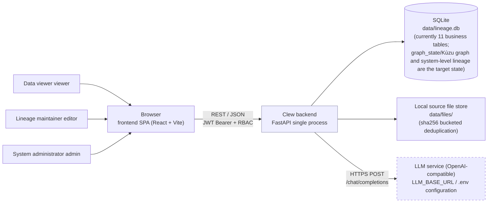
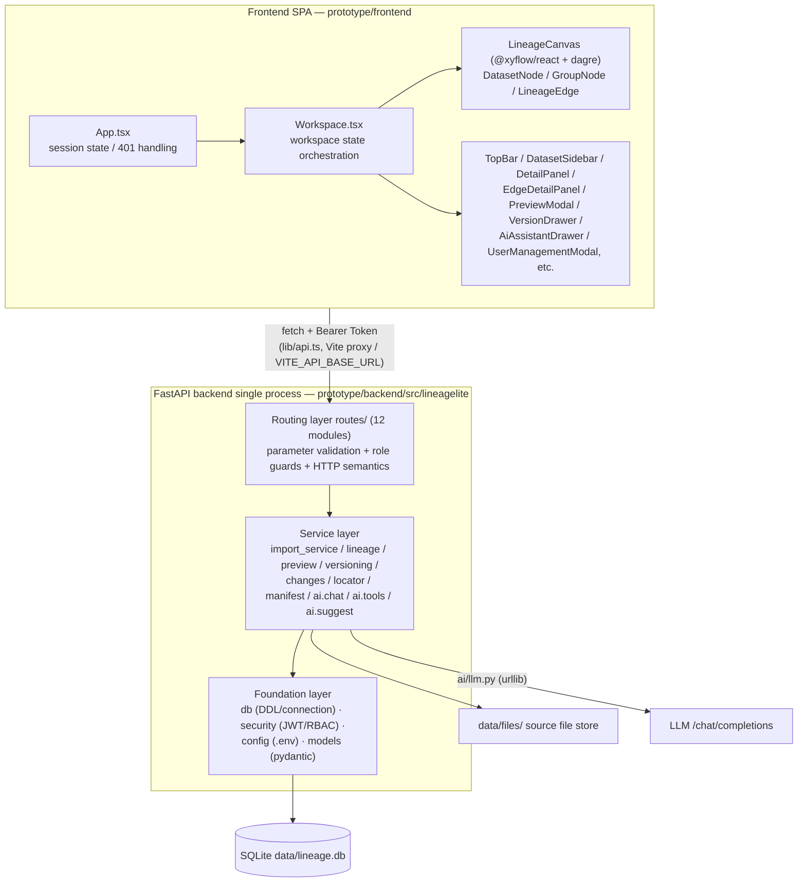
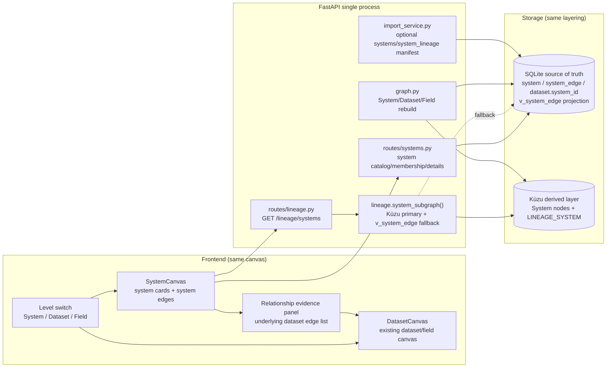

# Clew Architecture Design Document

> This document is the architecture view of LineageLite (a lightweight AI data lineage tool), compiled from the three design documents in `docs/01_design/` and the `prototype/` frontend/backend implementation (M1–M4): it answers "what parts the system consists of, how data flows, and what the dependency and deployment forms are". For business semantics see the business model; for table structures and API contracts see the data model; for frontend and API details see ./02_frontend-development.md and ./05_api-reference.md respectively. This document does not repeat them.

## Basis and Sources

| Abbreviation | Document / Code Location | Scope Used in This Document |
|---|---|---|
| Design proposal | `docs/01_design/clew-design-proposal.md` | §II Goals and Scope, §VIII Overall Architecture, §X Confirmed Decision Record (2026-10-23), etc. |
| Business model | `docs/01_design/clew-business-model.md` | §I Business Positioning, §III Domain Terminology, §V Business Flows, §VI Invariants |
| Data model | `docs/01_design/clew-data-model.md` | §I Model Overview, §V Identifier Naming, §VI Index Strategy, §VII Version Reconstruction, §IX API Contract Increments |
| README | Repository root `README.md` | Implemented feature scope, startup method, known gaps |
| Backend code | `prototype/backend/src/lineagelite/` (including `routes/` and `ai/` subdirectories) | Module breakdown and current data flow (descriptions follow the code) |
| Frontend code | `prototype/frontend/src/` (`App.tsx`, `components/Workspace.tsx`, etc.) | Top-level organization |

Terminology (dataset / field / source file / source locator / lineage edge / import batch / version tag / annotation / change log / AI lineage suggestion) follows the domain terminology table in §III of the business model. Code references in this document use repository-relative paths; where design documents and code diverge, the description follows the current code and the divergences are listed explicitly in §VII.

---

## I. System Positioning and Context

### 1.1 Target Users and Problems Solved

**Target users**: individuals / small teams — data lineage maintainers and consumers who can independently operate this tool (design proposal §II); stakeholders fall into three categories (business model §II):

| Business Role | System Role | Main Activities |
|---|---|---|
| Data viewer | `viewer` | Browse the lineage graph, view field details, source preview, AI read-only Q&A |
| Lineage maintainer | `editor` | Upload source files, import manifests, correct and edit, create edges, annotate, tag versions, confirm AI suggestions |
| System administrator | `admin` | User and role management, rollback by batch/tag, delete datasets |

**Problems solved** (design proposal §II, business model §I): users import second-hand data they have compiled themselves (CSV / XLSX / JSON) into the system; the system presents the provenance of the data as a **field-level lineage graph** and guarantees that **every field can be traced back in one click to the exact location in the first-hand source file** (worksheet / header path / column / row range / JSONPath). First-hand source files are hosted by the system, and locators undergo **actual-file verification** at import time, so that "second-hand lineage" can always be checked against "first-hand material". Supplementary capabilities: versioned management and rollback, audit trails for all operations, AI natural-language lineage queries, and suggestions for missing lineage (subject to manual confirmation).

**Explicit non-goals** (design proposal §II non-goals): no SQL parsing for automatic collection and no scheduler/connector ecosystem; no Elasticsearch/OpenSearch; no object-level ACL (workspace-level RBAC is the upper bound).

### 1.2 System Context

Within the system boundary there are only two first-party processes/artifacts (frontend SPA, FastAPI backend) and two local persistent data stores (SQLite database, source file directory); the only external service dependency is an OpenAI-compatible LLM service.



Key points:

- All three roles access the system only through the browser; there are no other access channels (no CLI, no third-party callbacks);
- Both SQLite and the source file directory reside on the backend host under `DATA_DIR` (default `./data/`); `storage_path` is never exposed externally, and all access goes through controlled APIs (business model §VI invariant #8);
- The LLM is the only external runtime dependency; when it is not configured, the rest of the system is unaffected (see §IV degraded behavior).

---

## II. Overall Architecture and Module Breakdown

### 2.1 Layered View

Four layers from top to bottom: **frontend SPA → REST API routing layer → service layer → storage layer**. Differences from §VIII of the design proposal: the `importer` in the design diagram is split in code into three modules — manifest normalization (`manifest.py`) + locator verification (`locator.py`) + import orchestration (`import_service.py`); the "FTS5 search" noted in the design diagram is not actually implemented (LIKE fuzzy matching, see §7.2).



Layering rules (summarized from the current code):

- The routing layer contains no business logic; it only converts parameters/permissions/error codes (`HTTPException` 400/401/403/404/409/502/503);
- Service-layer modules can be **reused** by the routing layer and the AI tool layer (for example, `ai/tools.py` calls `lineage.py` and `preview.py` directly instead of having the backend call its own REST API);
- All SQL goes through the `db.get_db()` context manager: `commit` on success and `rollback` on exception, with connection-level `PRAGMA foreign_keys = ON` (`prototype/backend/src/lineagelite/db.py`).

### 2.2 Backend Module Breakdown

| Module (relative to `prototype/backend/src/lineagelite/`) | Responsibility |
|---|---|
| `main.py` | Application assembly: registers 12 routes, CORS middleware, lifespan startup initialization (create database + create initial administrator when the user table is empty) |
| `config.py` | Reads the repository-root `.env` (pydantic-settings) and provides path resolution via `db_path()` / `files_dir()` / `resolve_storage()` |
| `db.py` | SQLite connection, DDL and indexes for 11 business tables (including a partial unique index for edge uniqueness), `get_db()` transaction context; the system-level lineage target state adds `system` / `system_edge` and `dataset.system_id` |
| `models.py` | pydantic API models and import record structures (`DatasetFieldRecord` / `LineageEdgeRecord` / `ImportReport`), defining the locator envelope `{type, input, resolved}`; the system-level target state adds `SystemRecord` / `SystemEdgeRecord` / `SystemGraphPayload` |
| `security.py` | Authentication and RBAC: pbkdf2 password hashing, JWT issuance/validation, `require_role` FastAPI role guard |
| `manifest.py` | Manifest normalization: CSV dual-file / XLSX dual-sheet / JSON single-file → unified record model; the system-level target state optionally supports `systems` / `system_lineage` |
| `locator.py` | Structural validation of source locators and actual-file verification: csv column resolution, xlsx multi-level header expansion and merged-cell anchor normalization, json JSONPath matching |
| `import_service.py` | Import orchestration: row-level validation → persist systems/datasets/fields before lineage/system_lineage → write change_log → generate import report |
| `lineage.py` | Lineage subgraph query: recursive CTE to compute the N-hop closure and load `GraphPayload` (dataset-seed / field-seed semantics); the system-level target state adds `system_subgraph()` (Kùzu primary + `v_system_edge` fallback CTE) |
| `graph.py` (target state) | Kùzu dual-write/dirty marking/full rebuild: Dataset/Field/System nodes and LINEAGE_FIELD/TABLE/SYSTEM relationships; `clew graph audit/rebuild` |
| `preview.py` | Source preview: opens the hosted source file according to the locator envelope and returns the data needed for highlighting (three structures: csv/xlsx/json) |
| `versioning.py` | Version management: rollback by batch/by tag (reverse-applying change_log, idempotent), tag creation/diff, current snapshot; the system-level target state reverse-applies `system` / `system_edge` / `dataset.system_id` |
| `changes.py` | Change-log writing and row snapshot utilities (`FIELD_SNAPSHOT_KEYS` / `EDGE_SNAPSHOT_KEYS`; snapshots exclude audit columns); the system-level target state adds `DATASET_SNAPSHOT_KEYS` / `SYSTEM_SNAPSHOT_KEYS` / `SYSTEM_EDGE_SNAPSHOT_KEYS` |
| `seed_demo.py` | Demo data script: generates csv/xlsx/json source files on the fly and exercises the real upload + import path |
| `routes/auth.py` | Authentication and user management: login (JWT issuance), current user, admin create/list users |
| `routes/files.py` | Source file hosting: batch upload (sha256 deduplication, type allowlist, size limit), listing, controlled download |
| `routes/imports.py` | Three-step import API, batch/report queries, rollback by batch (admin), plus `GET /lineage/snapshot` for M1 verification |
| `routes/datasets.py` | Basic dataset and field browsing (`GET /datasets`, including `field_names` for sidebar search) |
| `routes/lineage.py` | Lineage subgraph query API (`GET /lineage/subgraph`, validating hops 1–5 / direction); the system-level target state adds `GET /lineage/systems` |
| `routes/systems.py` (target state) | System catalog CRUD, system details, dataset membership; system graph seed existence/parameter validation; editor+ write, admin delete |
| `routes/preview.py` | Field source preview API (invalid location converted to 409, with `file` metadata and `verification`) |
| `routes/annotations.py` | Annotation API: append-only creation (target existence validated at the application layer) and query by target |
| `routes/fields.py` | Field manual editing API: description/type/locator modification (locators must be re-verified against the actual file; failure 409) |
| `routes/edges.py` | Lineage edge manual editing API: create edge (source='manual'), modify transform/note/confidence, delete edge |
| `routes/changes.py` | Change history query API (filter by entity, id descending, before/after parsed as JSON) |
| `routes/version_tags.py` | Version tag API: create, list, diff between tags, rollback to tag (admin) |
| `routes/ai.py` | AI API: status; chat (non-streaming / SSE streaming, viewer+, tool-layer role guardrails R8); lineage suggestions and confirm/reject, description draft accept/reject (editor+); rate limiting mounted (R11) |
| `ai/llm.py` | LLM access layer (LangChain `ChatOpenAI` / `OpenAIEmbeddings`, 07 D1/D5): `complete` / `stream_chat` / `get_embeddings`, 60s timeout, throws `LLMNotConfigured` when unconfigured |
| `ai/tools.py` | LLM tool set of 8: 6 read-only (`search_fields` / `get_field_details` / `trace_lineage` / `get_field_history` / `mark_highlight` / `analyze_impact`) + 2 write-type (`suggest_lineage` / `draft_descriptions`, tool-layer role validation R8). Read-only tools reuse the service layer |
| `ai/chat.py` | Chat orchestration: function calling loop (max 5 rounds, forced closure when exceeded); context budget (tool results >4000 characters truncated + whole-block pruning against the token budget, R10); stop on disconnect (`ChatInterrupted`, R9); outputs `answer` / `tool_trace` / `graph` / `highlights` |
| `ai/suggest.py` | Lineage suggestions (does not call LLM/chat): heuristic same-name 0.7 / containment 0.6 (semantic layer added after embeddings are configured per D5), persisted with source='ai', converted to manual after confirmation |
| `ai/descriptions.py` | Description draft flow (07 D3): generation persists to `description_draft` (`lang` parameterized R12); accept → annotation, reject → no repeated generation |
| `ai/mcp_server.py` | MCP stdio read-only server (07 D4): 5 query tools, no write capability exposed |
| `ai/ratelimit.py` | In-memory sliding-window rate limiting for AI routes (08 R11): `ai_limiter` dependency factory, 429 + `Retry-After`, no third-party dependencies |

> Note: The AI rows in the table above (routes/ai.py and ai/*, 8 rows in total) have been corrected to match the official engineering state as of 2026-10-26 (`backend/src/clew/`); the remaining rows describe the prototype (M1–M4) baseline, and the official directory is a same-source port (see the path reference convention in docs/README).

### 2.3 Frontend Top-Level Organization

`prototype/frontend/src/` (details in ./02_frontend-development.md):

- `App.tsx`: session root component — renders `LoginPage` when there is no session and `Workspace` when there is one; listens for `AUTH_EXPIRED_EVENT` dispatched by `lib/api.ts` (any request returning 401), clears the `localStorage` session, and returns to the login page;
- `components/Workspace.tsx`: the sole workspace orchestration component, holding state such as the dataset list, subgraph, selection state, canvas filters (confidence/source), and overlay switches; `applyGraph()` unifies **regular subgraphs and AI-generated graphs into the same GraphPayload rendering entry point** (the implementation of design proposal §5.2);
- All other components are presentational pieces composed by Workspace: `LineageCanvas` (@xyflow/react canvas + `lib/layout.ts` dagre layering), `DetailPanel` / `EdgeDetailPanel` (field/edge details and editing, annotations, history), `PreviewModal` (source preview), `DatasetSidebar`, `VersionDrawer` (batches/tags/rollback), `AiAssistantDrawer`, `UserManagementModal` (admin);
- The 8 overlays are uniformly wired to `lib/useOverlayBehavior.ts` (Esc handled by the topmost overlay + Tab focus trap + focus save/restore + body scroll lock) and the `components/ModalShell.tsx` base (document 08 R13); new overlays must use the same base to prevent keyboard behavior drift;
- `lib/api.ts`: the sole network exit (`fetch`), `API_BASE = VITE_API_BASE_URL ?? ''` (default empty = same-origin relative path); `lib/roles.ts` hides write entry points based on `canEdit` / `admin`.

### 2.4 Target Architecture for System-Level Lineage (added by the 2026-11 design; code pending implementation)

System-level lineage **adds no new processes/storage components**; it merely adds a "system" view on top of the existing four layers:



**Responsibility boundaries (mandatory)**:

1. The system catalog, membership, explicit edges, and system search all reside in SQLite; the system-level relationship view `v_system_edge` is "explicit edges ∪ dataset edge projection" and is not materialized;
2. Kùzu stores only system nodes and `LINEAGE_SYSTEM` relationship instances for N-hop traversal; `system_edge_id` links back to SQLite (-1 for pure projected edges);
3. System level and dataset/field level share the same `GraphPayload` rendering entry point (distinguished by the `level` field); AI-generated graphs and manual browsing do not fork;
4. Failed system-level queries fall back to the `v_system_edge` recursive CTE according to the existing graph routing, without introducing a new fallback branch;
5. System-level write operations (systems/membership/explicit edges) mark `dirty` after the main database transaction commits, and the read path performs a full Kùzu rebuild — **no per-row incremental sync**, avoiding double-write drift of the system projection.

**Gaps versus the existing code**: currently `backend/src/clew` and `prototype` have only dataset/field/edge and recursive CTEs; there is no `system` table, `v_system_edge`, or Kùzu graph layer. Implementing the target state requires following data model §2.13/§2.14/§3.3/§X and design proposal §4.7, plus migration scripts (`ALTER TABLE dataset ADD COLUMN system_id`, rebuild of the `change_log`/`annotation` CHECK constraints).

---

## III. Key Data Flows

### 3.1 Source File Hosting + Import (Upload → Manifest Validation → Actual-File Verification → Batch Persistence)

Corresponds to business model §5.1; the design principle "no location, no persistence" (invariant #1) is enforced at the end of the chain.

```mermaid
sequenceDiagram
    participant U as Maintainer (editor+)
    participant API as routes/files.py · routes/imports.py
    participant SVC as manifest.py · locator.py · import_service.py
    participant FS as data/files/
    participant DB as SQLite

    U->>API: ① POST /files (multipart batch, csv/xlsx/json, ≤50MB each)
    API->>FS: write files/{first 2 chars of sha}/{sha}.{extension} by sha256
    API->>DB: same sha256 already exists → reuse the source_file record (deduped)
    API-->>U: source_file list (id, original_name, src_type)

    U->>API: ② POST /import (format + source_file_ids + manifest file)
    API->>SVC: manifest normalization (csv dual-file / xlsx dual-sheet / json single-file)
    SVC->>DB: create import_batch (version_no increments) — single transaction begins
    loop each dataset row
        SVC->>SVC: required fields/src_type/src_file unique-location validation
        SVC->>SVC: pydantic locator structural validation (LOCATOR_MODELS)
        SVC->>FS: actual-file verification: open the hosted file and parse the locator (locator.CHECKERS)
        SVC->>DB: _ensure_dataset + _upsert_field (materialize the resolved envelope; write change_log added/updated)
    end
    loop each lineage row
        SVC->>SVC: reference/mixed-field-edge/confidence validation; deduplicate and merge by natural key
        SVC->>DB: insert or update edge (source='imported'; write change_log)
    end
    SVC->>DB: write the summary report to import_batch.report — transaction commits
    API-->>U: {batch_id, version_no, report} (per-row ok/merged/rejected + reason + line number)
```

Key points:

- `src_file` reference resolution supports **either a source file store ID or the original file name within the batch's bound file set** (must resolve uniquely, `import_service._resolve_source_file`);
- Rows that fail validation are **rejected individually into the report without blocking the whole batch**; `run_import` runs entirely within a single `get_db()` transaction (any exception rolls back everything);
- Actual-file verification also performs **parse materialization**: `resolved` (column_index / anchor / merged_anchors / hits, etc.) is written into `field.src_locator` together with the envelope, so historical locations remain reviewable even after source file headers change (design proposal §3.2);
- See data model §4.3 for the report structure; it can be retrieved as JSON via `GET /import/batches/{id}`.

### 3.2 Lineage Subgraph Query (Recursive CTE)

Corresponds to design proposal §4.3 and business model §5.5; "fetch the entire subgraph in one query, no N+1" is the core architectural difference from the two major open-source solutions.

```
GET /lineage/subgraph?dataset=&field=&hops=&direction=   (viewer+)
        │
        ▼
routes/lineage.py ── parameter validation (hops 1–5, default 3; direction both/up/down) + seed existence (404)
        │
        ▼
lineage.lineage_subgraph()
        ├─ dataset seed: WITH RECURSIVE reach(dataset_id, hop) — expand the N-hop closure along all edges
        ├─ field seed: WITH RECURSIVE reach(dataset_id, field_name, hop)
        │     · field-level edges: exact linkage via from_field/to_field
        │     · table-level edges (field NULL on both sides): COALESCE-expand to all fields of the target-side dataset
        │       (LEFT JOIN field on one side only, avoiding row multiplication)
        ▼
lineage._payload(closure dataset list)
        ├─ one SELECT loads all fields in the closure (including locator envelope + source file name; malformed envelopes degrade to empty neutral values)
        ├─ one SELECT loads all edges within the closure (including id/confidence/source)
        ▼
GraphPayload { datasets: [{id, name, fields[]}], edges: [...] }
        │
        ▼
frontend Workspace.applyGraph(): regular subgraphs and AI-generated graphs share the same rendering entry point; dagre left-to-right layered layout
```

The recursive CTE uses only standard syntax supported by both SQLite and PostgreSQL (`lineage.py` module notes), preserving the Postgres upgrade path. Table-level lineage is always a projection of field-level lineage and is never stored twice (data model §3.1).

### 3.3 Source Preview

Corresponds to the "source verification" loop in business model §5.2.

```
Click a field in the lineage graph → locator card (source file name + human-readable locator form)
        │ click preview
        ▼
GET /fields/{dataset_id}/{field_name}/preview   (viewer+)
        │
        ▼
preview.field_preview(field.src_locator envelope)
        ├─ resolve_storage() locates the hosted file (storage_path is never exposed)
        ├─ csv: first-row header + column index + first 50 data rows
        ├─ xlsx: sheet, header rows, merged regions, column index, row range + first 50 data rows
        └─ json: JSONPath + total hit count + first 10 matched values
        ▼
response = preview structure + file metadata (id/original_name/sha256/...)
       + verification (version_no / checked_by / checked_at of the most recent successful actual-file verification)
        │
        ▼
frontend PreviewModal highlights the sheet / header path / column and row range / JSONPath matched values
```

When the locator is **no longer valid** for the current file (missing file, nonexistent sheet, materialized row/column out of bounds, no JSONPath hits), a `PreviewError` is raised, the routing layer converts it to **409**, and the frontend displays the reason — "invalid location" is designed as an expected state rather than an exception (implementation notes in data model §4.1).

### 3.4 AI Chat (Function Calling Tool Orchestration + Role Guardrails)

Corresponds to design proposal §VI, business model §5.5/§5.6, and [07_AI module evolution plan](./07_ai-module-evolution-plan.md). Tools are divided into 6 read-only and 2 write-type (which persist to candidate/draft workspaces and require manual confirmation, invariant #4); **write-type tools are re-validated at the tool layer against the caller's role, so a viewer triggering them through chat is rejected and nothing is written to the database** (document 08 R8 — the viewer threshold on the chat path therefore no longer constitutes a permission bypass). Tool results are truncated (>4000 characters) before being stitched back into the conversation and pruned in whole blocks according to the budget, ensuring that long conversations/large subgraphs do not overflow the context window (document 08 R10).

```mermaid
sequenceDiagram
    participant U as User (viewer+)
    participant R as routes/ai.py
    participant C as ai/chat.py
    participant L as LLM service (/chat/completions)
    participant T as ai/tools.py

    Note over R: ai/ratelimit.py: per-user rate limiting (over limit 429, document 08 R11)
    U->>R: POST /ai/chat/stream {messages[], focus?{dataset,field}}
    R->>C: stream_run_chat() (background thread + event queue)
    Note over C: system prompt (anti-hallucination constraints + focus scope) + conversation history
    loop up to 5 tool-call rounds
        C->>C: check cancellation signal (client disconnect → terminate with ChatInterrupted, document 08 R9)
        C->>L: llm.stream_complete(conversation, tools) (token by token via queue → SSE)
        L-->>C: message (with tool_calls)
        loop each tool_call
            C->>T: run_tool(conn, name, args, actor, role)
            alt write-type tool and role < editor (suggest_lineage / draft_descriptions)
                Note over T: execution denied: error returned to the model, nothing written (invariant #4 / R8)
            else read-only tool or editor+ write-type tool
                Note over T: read-only reuses the service layer; write-type persists to candidates/drafts (manual confirmation required)
            end
            T-->>C: JSON result (truncated at >4000 characters before stitching; trace_lineage carries GraphPayload → recorded as graph)
        end
        C->>C: context exceeds token budget → prune the oldest rounds in whole blocks (R10)
        C->>L: send back role=tool messages, continue to the next round
    end
    Note over C: no tool_calls or 5-round limit reached: force closure without tools
    L-->>C: token stream → SSE; gap >15s: comment frame ": ping" heartbeat (R9)
    R-->>U: SSE: token / tool / suggest / drafts / done / error
```

- LLM not configured: `/ai/status` returns `configured=false`, chat endpoints return **503** (streaming mode emits an in-stream `error` event); upstream unreachable/non-200/invalid structure: **502** (`ai/llm.py`); over limit: **429** with `Retry-After` (`ai/ratelimit.py`, R11);
- `graph` takes the GraphPayload of the last `trace_lineage` call, and the frontend canvas switches in sync (same rendering protocol as §3.2; graph/highlights extraction happens before truncation and is unaffected by the budget);
- **Lineage suggestions are an independent path** (not via the LLM): `POST /ai/suggest` (editor+) generates candidate edges by heuristics (same name 0.7 / containment 0.6; a semantic layer is added after embeddings are configured per D5), persists them with `source='ai'`, and writes change_log(added); confirm (converts to `manual`) / reject (deletes) go through their respective endpoints — **AI cannot take effect directly** (invariant #4);
- Stop on client disconnect (R9): tool rounds that have not started (including write-type persistence) are no longer executed; 15s heartbeat frames during event gaps prevent reverse-proxy disconnections;
- The MCP server (`ai/mcp_server.py`, stdio) exposes only 5 read-only query tools to external AI clients and has no write capability (07 D4).

### 3.5 Version Rollback

Corresponds to design proposal §4.2 and data model §VII; "versions are reversible" invariant #7. History stores no snapshots; **rollback = reverse-applying change_log**.

```
Rollback by batch                                Rollback by tag
POST /import/batches/{id}/rollback (admin)       POST /version-tags/{name}/rollback (admin)
        │                                              │
        ▼                                              ▼
versioning.rollback_batch()                      versioning.rollback_to_tag()
  · fetch all change_log entries of the batch      · fetch all logs with change_seq > tag.change_seq
  · reverse-apply in descending id order:            (across batches + manual edits with batch_id=NULL)
    added→delete, updated→restore before,          · same reverse-apply function, descending order
    deleted→reinsert before; idempotent            · reversed batches also write rolled_back_at/by
  · foreign-key/unique conflict → 409              · append rollback_record audit (tag, range,
  · batch writes rolled_back_at/by                    reverted, actor, timestamp) — rollback writes
    (rolling back an already rolled-back batch → 409)  no change_log, keeping repeated rollbacks safe
        │                                              │
        └──────────────────┬───────────────────────────┘
                           ▼
        completed within a single get_db() transaction; annotations do not participate in rollback and are retained permanently
```

Supporting capabilities: `GET /version-tags/diff?from=&to=` merges by `(entity_kind, entity_key)` within the change_seq range between two tags, using the first before in the range as the starting point and the last after as the endpoint to produce the net change (`versioning.tag_diff`); `GET /changes` serves field/edge history views. Snapshot key sets exclude audit columns; when reinserting a deleted row, `created_by` is restored from the earlier added log (`versioning._edge_created_by`).

### 3.6 System-Level Upstream/Downstream Query (Target State)

Corresponds to design proposal §4.7 / §5.3 and data model §3.3 / §10.5. The system graph is not a new path; it moves the existing query routing of "fetch entities from SQLite + fetch topology from Kùzu" up one level:

```
GET /lineage/systems?system=&hops=&direction=   (viewer+)
        │
        ▼
routes/lineage.py ── parameter validation (hops 1–5, default 3; direction both/up/down) + seed existence (404)
        │
        ▼
graph_state clean?
   ├─ yes → Kùzu:
   │      upstream MATCH p=(s:System {id:$sid})<-[:LINEAGE_SYSTEM*1..n]-(up:System)
   │      downstream MATCH p=(s:System {id:$sid})-[:LINEAGE_SYSTEM*1..n]->(down:System)
   │      RETURN DISTINCT id, min(length(p)) AS hop
   └─ no → rebuild automatically; on failure, SQLite performs a recursive closure over v_system_edge (fallback)
        │
        ▼
SQLite hydrate: system properties + dataset_count + v_system_edge edge properties
        │
        ▼
SystemGraphPayload { level:"system", seed, systems[], edges[], graph_state, engine }
        │
        ▼
frontend same canvas: level switch → system cards/system edges; select an edge → relationship evidence panel
        │
        ▼
evidence drill-down: look up edge details by both endpoint systems → click to jump to the dataset/field view
```

**Cycle handling**: system-level projection may produce cycles (even when the dataset level is acyclic, aggregation can produce cycles). Queries must use `DISTINCT` + `min(hop)`, with a hop limit of 1–5; `clew graph audit` reports cycles; the UI marks a "system-level aggregation cycle" and does not use it to conclude that the dataset level has a cycle.

**Relationship to the dataset/field graph**: the system graph reads only `v_system_edge` and `system`; the dataset/field graph still uses the existing `lineage.py` recursive CTE (target-state Kùzu `LINEAGE_FIELD/TABLE`). Both share the `GraphPayload` rendering protocol and the frontend `applyGraph` entry point, but their data queries are not nested within each other.

---

## IV. External Dependencies

**The only external service: LLM (OpenAI-compatible Chat Completions)**

| Item | Description |
|---|---|
| Endpoint | `{LLM_BASE_URL}/chat/completions` (`ai/llm.py` supports both the `…/v1` form and the fully written `…/v1/chat/completions` form) |
| Configuration | Repository-root `.env`: `LLM_BASE_URL` / `LLM_API_KEY` / `LLM_MODEL` (`.env.example` is committed, `.env` is not — design proposal §X decision #5) |
| Client | Standard library `urllib` only, 60-second timeout, no third-party SDK; `LLM_API_KEY` may be empty (compatible with local services that require no authentication) |
| Configured determination | Considered configured when both `base_url` and `model` are non-empty |
| Unconfigured degradation | `/ai/status` → `configured=false` (does not return the key); `/ai/chat` → 503; import, graph queries, preview, versions, and all other features are unaffected; `/ai/suggest` is purely heuristic, does not depend on the LLM, and runs offline |
| Upstream errors | Unreachable / non-200 / invalid response structure → `LLMError` → routing layer 502 |

**No other external services**: no message queue, no Elasticsearch/OpenSearch, no object storage (source files are stored locally in `data/files/`; an S3/MinIO abstraction is `[TBD-INFRA]`), no standalone cache/gateway. Everything else is Python library dependencies (`pyproject.toml`): fastapi, uvicorn, pydantic / pydantic-settings, python-multipart, openpyxl (xlsx parsing), pyjwt (JWT), jsonpath-ng (JSONPath); frontend runtime dependencies are @xyflow/react and @dagrejs/dagre (README).

---

## V. Deployment Form

**Current form: local single-machine development/use** (README; design proposal §VIII "single process, single storage").

| Component | Startup / Hosting |
|---|---|
| Backend | `uv run uvicorn lineagelite.main:app --reload` (default 127.0.0.1:8000); on first startup the lifespan automatically runs `init_db()` to create the database and creates the initial administrator based on `ADMIN_USERNAME` / `ADMIN_PASSWORD` from `.env` |
| Frontend (development) | `npm run dev` (Vite 5173); `vite.config.ts` proxies the 12 prefixes `/auth` `/datasets` `/lineage` `/fields` `/edges` `/annotations` `/changes` `/version-tags` `/users` `/files` `/import` `/ai` to `http://127.0.0.1:8000` |
| Frontend (build artifacts) | `npm run build` (`tsc -b && vite build`); the artifacts can be hosted by any static service: the default `API_BASE` is empty, using same-origin relative paths (same-origin reverse-proxy scenario); for cross-origin deployment, set `VITE_API_BASE_URL` to point at the backend |
| CORS | `CORS_ORIGINS` (comma-separated allowlist, by default only local 5173); authentication uses Bearer rather than cookies, hence `allow_credentials=False` (`main.py` comment) |
| Data | `DATA_DIR` (default `./data/`): `lineage.db` (SQLite) + `files/` (source file store) |

**Reserved upgrade paths** (design proposal §II, not yet implemented):

- **SQLite → PostgreSQL**: all SQL is written to a compatible subset + recursive CTEs; migration notes (data model §VII): `AUTOINCREMENT` → `GENERATED ALWAYS AS IDENTITY`, time columns TEXT → `timestamptz` (or BIGINT epoch ms), field search `LIKE` → `tsvector` + GIN; recursive CTEs and composite FK semantics remain consistent and need no changes;
- **Local files → S3/MinIO**: the storage backend is abstracted behind an interface (`[TBD-INFRA]`, determined by the deployment environment; a local implementation has been in place since M1).

---

## VI. Architecture Decision Summary

All items below are distilled from §X "Confirmed Decision Record (2026-10-23)" and the design trade-offs already fixed in §II/§VIII of the design proposal, with sources noted; this document introduces no new decisions.

| # | Decision | Architectural Implication | Source → Code Location |
|---|---|---|---|
| 1 | Multi-user permissions: workspace-level RBAC (admin/editor/viewer) + JWT + audit trails for all operations, no object-level ACL | Authentication uses no cookies/sessions; `require_role` dependency injection declares the minimum role per route; `created_by/actor/author` always come from the JWT | Design proposal §X#1, §4.4 → `security.py`, each `routes/*` |
| 2 | Version business tags: `version_tag` anchors a position in change_log, supporting diff between tags and rollback to a tag | No full snapshots; four layers "current state + import batch + tag + change log", rollback = reverse-applying logs | Design proposal §X#2, §4.1/4.2 → `versioning.py`, `change_log`/`version_tag`/`rollback_record` tables |
| 3 | Hosted source file upload: `source_file` table + sha256 deduplication + controlled preview/download | Actual-file locator verification is possible at import time; the canvas locator card can preview the region; `storage_path` is never exposed | Design proposal §X#3, §3.5/3.6 → `routes/files.py`, `locator.py`, `preview.py` |
| 4 | XLSX complex headers: merged-cell anchor normalization + multi-level header `header_path` expansion + materialized parse results | Locator resolution is centralized and completed once at import time; persisted `resolved` makes historical locations reviewable | Design proposal §X#4, §3.2 → `locator.py`, `field.src_locator` envelope |
| 5 | LLM provider: OpenAI-compatible API, configured in the repository-root `.env`, `.env` not committed | The LLM is the only external service and can be degraded entirely (503/502); keys never enter code or responses | Design proposal §X#5, §II → `config.py`, `ai/llm.py`, `GET /ai/status` |
| 6 | UI layout: the low-fidelity prototype is the UI baseline, with 6 screens in total | Frontend component split corresponds to 6 screens: canvas, source file preview, import wizard, AI chat, versions and users, login | Design proposal §X#6, §V → `prototype/frontend/src/components/` |
| A | Single process, single storage, no message queue, no search cluster | DataHub's event-driven approach is replaced by "synchronous writes + a change_log table"; OpenMetadata's dual DB+ES query path is replaced by "a single recursive CTE path" | Design proposal §I.3, §VIII → `main.py` single application, `lineage.py` |
| B | File import is a first-class citizen (CSV/XLSX/JSON manifests), with no SQL parsing for automatic collection or connector ecosystem | The importer is the core write path; the system boundary is clear: data enters only via "upload + import" | Design proposal §I.3, §II → `manifest.py`, `import_service.py` |
| C | Tool-based AI interface: verbose lineage output + read-only tools | AI consumes system data through structured tool calls rather than free-text page scraping | Design proposal §I.3, §VI → `ai/tools.py`, `ai/chat.py` |
| 9 | System-level upstream/downstream: `system` + `dataset.system_id` + `system_edge`; system graph = explicit edges ∪ dataset edge projection | System properties/search live in SQLite; system-level N-hop traversal uses Kùzu `LINEAGE_SYSTEM`; system edges are not materialized or double-written; the projection is computed in real time by `v_system_edge`; the same GraphPayload rendering protocol is reused | Design proposal §4.7 → target-state `routes/systems.py`, `lineage.system_subgraph()`, `graph.py` |
| 10 | Explainable system edges: `origin` + `dataset_edge_count` + underlying dataset edge list; system-level aggregation cycles are allowed but must be detected and surfaced | The system view must not draw "lines with unexplainable origins"; cycles are handled with DISTINCT + min(hop) + a hop limit; unassigned datasets do not get fabricated virtual system nodes | Design proposal §4.7.4/§5.3 → data model §3.3, frontend system canvas/evidence panel |

---

## VII. Known Gaps and Evolution Points

### 7.1 Gaps Declared in the README

- **User management prototype fidelity**: `UserManagementModal` supports only user listing + adding users (with role selection); the per-row role dropdown and RBAC permission matrix on the prototype's "Versions and Users" screen are not implemented. Role changes require new administrator endpoints and involve business rules such as "whether administrators may change their own roles / how to guarantee that at least one admin remains" (`[TBD-BIZ]`, requires product confirmation).
- **Annotation management**: annotations are append-only with no edit/delete entry (consistent with the business model's "annotations are only added, never changed"; not a defect).

### 7.2 Inconsistencies Between Design Documents and Code (described as per the current code)

| # | Item | Design Document Claim | Current Code |
|---|---|---|---|
| 1 | Field search | Design proposal §II/§VIII says "SQLite FTS5 search" | No FTS5 virtual table is introduced; `search_fields` in `ai/tools.py` performs `LIKE` fuzzy matching against `field`/`dataset`/`annotation` (data model §3.2 already records this trade-off: LIKE suffices at small scale, while FTS5 would require trigger/dual-write maintenance) |
| 2 | AI tool set form | Design proposal §VI: "tools are thin wrappers around this system's REST API"; the tool table lists 6 types of tools such as `trace_upstream`/`trace_downstream`, `get_subgraph`, and `suggest_lineage` | `ai/tools.py` actually has 4 read-only tools: `search_fields`, `get_field_details`, `trace_lineage` (merges trace/subgraph semantics, with a direction parameter to distinguish direction), and `get_field_history`; tools reuse service-layer functions directly (`lineage.py`/`preview.py`, etc.) and do not call themselves over HTTP. Data model §9.3 records the implementation as built |
| 3 | Whether lineage suggestions call the LLM | Design proposal §6.4: "same-name/semantic-similarity/upstream-downstream-proximity heuristics **+ LLM judgment**" | `ai/suggest.py` is purely heuristic (same name 0.7 / containment 0.6) and **does not call the LLM**, so it runs offline; "semantic similarity/LLM judgment" is an evolution point (README and data model §9.3 record it per the implementation) |
| 4 | Table structure increments | The DDL in design proposal §4.1 has no `import_batch.rolled_back_at/by` and no `rollback_record` table | `db.py` already contains both (added in M1/M3 for rollback auditing and tag rollback audit); data model §2.6/§2.10 already includes them, while design proposal §4.1 was not updated retroactively |
| 5 | Endpoint naming | The tool table in design proposal §VI gives forms such as `GET /search?q=`, `GET /lineage/trace`, `GET /fields/{ds}.{f}`, and `GET /changes?entity=` | Implemented as `GET /lineage/subgraph?dataset=&field=&hops=&direction=`, `GET|PATCH /fields/{dataset_id}/{field_name}` (preview/edit), and `GET /changes?entity_kind=&entity_key=&limit=`; there is no standalone `/search` REST endpoint (search exists only as an internal AI tool capability). The contract increments in data model §IX prevail |
| 6 | Derived views | Data model §3.1 defines a `v_dataset_edge` SQL view | `db.py` does not create that VIEW (the intent of "derived, not persisted" is precisely not to materialize it); table-level projection semantics are expressed by the `lineage.py` closure query handling both field-level and table-level edges directly |
| 7 | Legacy endpoints | None | `routes/imports.py` retains `GET /lineage/snapshot` for M1 verification (the module comment says "M2 will replace it with the recursive CTE subgraph query"; it was not actually removed, and the README API list does not include it) |

### 7.3 Evolution Points (all sourced; not newly introduced here)

- **Postgres upgrade**: see §V; trigger conditions and timing are undecided (design proposal §II only reserves the path).
- **S3/MinIO storage backend**: `[TBD-INFRA]`, determined by the deployment environment (remaining open item in design proposal §X).
- **Dataset-level privacy/authorization**: currently all users in a workspace can see all datasets; a `dataset_acl` table would be introduced when a real need arises (`[TBD-BIZ]`, remaining open item in design proposal §X).
- **FTS5 / tsvector full-text search**: introduced after data volume grows (trade-off notes in data model §3.2); the interface and ranking semantics remain unchanged.
- **Semantic similarity + LLM judgment for suggest**: see §7.2#3.
- **Role changes and the RBAC matrix**: see §7.1 (`[TBD-BIZ]`).

### 7.4 System-Level Lineage Implementation Gaps (added by the 2026-11 design)

| # | Gap | Current State | Target State |
|---|---|---|---|
| 1 | Data tables | No `system` / `system_edge`; `dataset` has no `system_id` | Create tables and migrate per data model §2.13/§2.14; add `system`/`system_edge` to the `change_log`/`annotation` CHECK constraints; add `system_rel_count` to `graph_state` |
| 2 | System relationship view | No `v_system_edge` | Create the view per data model §3.3; explicit edges ∪ dataset edge projection with explainable `origin`/`dataset_edge_count` |
| 3 | Kùzu graph | Currently still a single SQLite recursive CTE (the graph migration itself has not landed) | Add `System` nodes, `Dataset.system_id`, and `LINEAGE_SYSTEM` together with the graph migration; rebuild by full import from `v_system_edge` |
| 4 | API | No `/systems`, `/lineage/systems`, `PATCH /datasets/{id}` | Implement per data model §9.6; system graph failures fall back to the `v_system_edge` CTE |
| 5 | Frontend | No level switch/system canvas/evidence panel | Implement per design proposal §5.3; the system graph and the existing canvas share `applyGraph` without building a second rendering architecture |
| 6 | Import | The manifest only has datasets/lineage | Optional `systems` / `system_lineage`; old manifests remain backward compatible; the report adds `kind=system/system_edge` |
| 7 | Versioning | `change_log` covers only field/edge | Add snapshots and reverse-apply for dataset (`system_id`), system, and system_edge; mark `dirty` for rebuild after rollback |

> The above items are finalized by design and pending implementation; the prototype [clew-system-lineage-prototype.html](../02_prototype/clew-system-lineage-prototype.html) is used to validate interaction and information architecture first and is not evidence of implementation completeness.

---

## Appendix: Division of Labor with Sibling Documents

- ./02_frontend-development.md: component tree, canvas interaction, and state management details;
- ./05_api-reference.md: request/response contracts for all REST endpoints (including the M2/M3/M4 increments in data model §IX);
- Table structures, indexes, JSON envelopes, and version reconstruction rules: `docs/01_design/clew-data-model.md` (the sole authority at the data layer).
